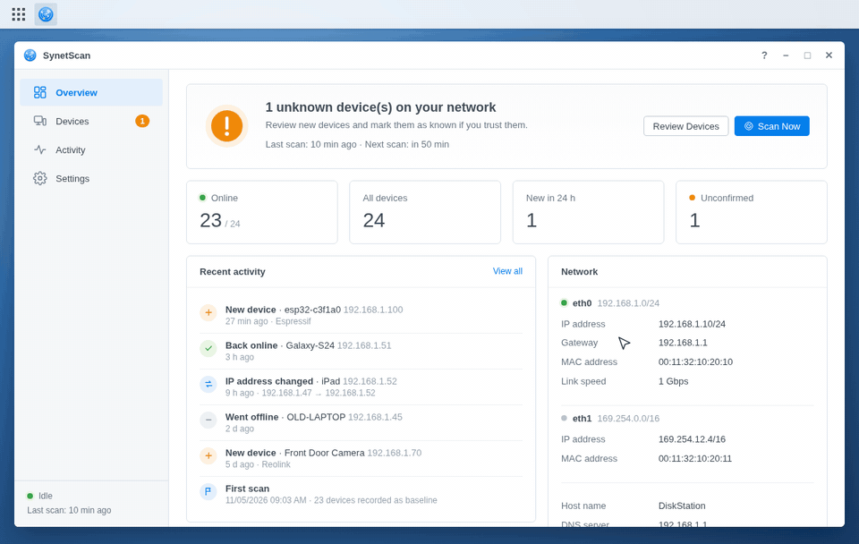

<div align="center">


<a name="readme-top"></a>

# SynetScan

**A network scanner for your Synology NAS.**<br/>
See every device on your network, know what it is, and notice when something new shows up.




<sub>Demo recorded with made-up data (<code>tools/demo/</code>).</sub>

</div>

SynetScan is a feature-rich network scanner. It scans your LAN on a schedule,
identifies and sorts every device it finds and flags any newly detected devices.
Open it from the DSM main menu like any other Synology app.

## ✨ Features

- **Finds everything on your LAN.** That includes devices that ignore ping or block every
  port, because SynetScan also uses the NAS's ARP table.
- **Speaks IPv6 too.** It shows each device's IPv6 addresses and finds devices that have no
  IPv4 address at all. Phones and PCs with changing privacy addresses stay one device.
- **Tells you what each device is.** It combines the MAC vendor (about 59,000 entries),
  host names (DNS, NetBIOS, Bonjour/mDNS), UPnP descriptions, open services and web page
  titles to name devices and sort them into 14 types: router, NAS, computer, phone, TV,
  printer, camera, smart home and more.
- **Flags new devices.** The first scan becomes your baseline; anything that joins later is
  marked **New** until you confirm it. The activity log also records devices going offline,
  coming back and changing their IP address.
- **Feels like part of DSM.** It opens as a normal DSM window, with DSM's own look:
  navigation, toolbars, tables, dialogs and right-click menus. It follows your DSM
  language (English or German) and time zone.
- **Gets things done in place.** Rename devices, correct their type, add notes, wake them
  with Wake-on-LAN, open their web interface (on the local network) or export the list as CSV.
- **Runs on its own.** Scans on a schedule from every 5 minutes to once a day, and a /24
  network takes about 10 seconds.
- **Safe by design.** Runs as an unprivileged package user (DSM 7 rules), only DSM
  administrators can use it, and every request is checked against your DSM session.
- **No extras needed.** It's a single `noarch` package for every model, using the Python 3
  that DSM 7 already ships. No Docker, no cloud account, no command line.

## ⚡️ Installation

1. Download the latest `SynetScan-<version>-noarch.spk` from the
   [Releases page](https://github.com/philiphohn/synetscan/releases/latest).
   You can also build it yourself with `./build.sh` (see Development below).
2. In DSM, open **Package Center → Manual Install** and choose the `.spk`.
   DSM will warn that the package is from an unknown publisher (it isn't signed
   by Synology). Confirm to continue.
3. Open **SynetScan** from the DSM main menu. After an update, reload the DSM page (F5)
   so the desktop picks up the new app entry. A first scan runs automatically when
   the service starts. The devices it finds become the "known" baseline, and any
   device that appears later is flagged as **New**.

Requirements: DSM 7.0 or newer and Python 3. DSM 7 already ships `/usr/bin/python3`.
If it is missing, install **Python 3.9** from Package Center first. The package is
`noarch`, so it installs on every model.

Only members of the **administrators** group can open the app. Both the DSM menu
entry and the API check this.

## 🔍 How it works

```
DSM window (iframe)  index.html · js/app.js · css/dsm.css
      │  fetch api.cgi?action=…   (DSM session cookie + SynoToken)
      ▼
api.cgi  ─ validates the session via DSM's authenticate.cgi, checks admin group
      │  JSON over unix socket  /var/packages/SynetScan/var/synetscan.sock
      ▼
synetscand  (package service, runs as the unprivileged package user)
  ├─ scheduler (periodic scans, scan on start)
  ├─ scanner   discovery → enrichment → classification
  └─ store     devices.json · events.json · scans.json · config.json
```

DSM 7 does not let third-party packages run as root, so raw ARP/ICMP sockets
aren't available. SynetScan works around this without privileges:

1. **Discovery.** For every address it sends a UDP datagram and makes a few
   parallel TCP connection attempts. Any answer, even a refusal, proves the host
   exists. These packets also force the kernel to ARP-resolve every address, so
   afterwards `/proc/net/arp`, which any user can read, lists every host that
   answered ARP. That includes completely firewalled devices.
   Hosts known only from the ARP cache are re-checked after the cache has settled,
   so devices that just left the network are not reported as online.
   `ping` is used too, if the system binary works for the package user.
2. **Enrichment.** For each discovered device:
   - a TCP port scan (configurable list)
   - reverse DNS
   - a NetBIOS node-status query
   - mDNS/Bonjour, both a DNS-SD browse and a unicast reverse lookup
   - SSDP/UPnP, including the device description XML
   - the HTTP title and Server header
   - vendor lookup from the MAC address (bundled Wireshark OUI database, about 59k entries)
3. **Classification.** Heuristics turn the vendor, ports, services and names into
   a device type: router, NAS, computer, server, phone, tablet, printer, camera,
   TV/media, speaker, console, smart home, network device, virtual machine.

4. **IPv6.** An IPv6 network (/64) has far too many addresses to try one by one, and
   ICMPv6 needs root. So SynetScan makes the devices answer instead, while the IPv4 devices
   are being identified:
   - mDNS, SSDP/UPnP and WS-Discovery queries to their IPv6 multicast groups, sent from the
     link-local and from each routable address of the NAS (devices reply from an address
     of the same kind, which reveals their routable addresses)
   - an echo to all nodes (`ff02::1`), where unprivileged ICMP sockets or the system `ping`
     are available
   - a datagram to the EUI-64 link-local address of every MAC already known from IPv4

   Every reply puts the device into the kernel's neighbour table, which SynetScan reads
   without privileges (netlink, or `ip -6 neigh`). Addresses are grouped by MAC address:
   those of known devices are added to them, and devices without IPv4 are port-scanned and
   identified like any other.

A /24 network takes roughly 8–15 seconds to scan, IPv6 included.

## 🧩 DSM integration

- **Window.** Since DSM 7.2 a `"type": "legacy"` app entry opens in a browser tab, where the
  page cannot use the DSM session. So `ui/config` registers an ExtJS application,
  `SYNO.SDS.SynetScan.Instance` (see `ui/synetscan.js`), whose `SYNO.SDS.AppWindow` holds
  `index.html` in an iframe. `dsmappname` in INFO names the same class, which is what Package
  Center's "Open" button uses.
- **Session token.** The UI reads the SynoToken from the DSM desktop (its parent window). It
  also receives it in the URL fragment, which no server or log ever sees. API calls send it
  only as the `X-SYNO-TOKEN` header, CSV export included.
- **Opened outside DSM.** If `index.html` is opened in a tab on its own, the page offers
  "Open in DSM", which goes to `/?launchApp=SYNO.SDS.SynetScan.Instance`.
- **Service socket.** The socket has mode `0600`. Only the package user, which DSM also runs
  the package CGI as, can reach the service; everyone else has to go through `api.cgi` and its
  DSM session and admin checks.
- **Local or remote.** "Open web interface" only works when the browser is in the NAS's
  network. `api.cgi?action=client` compares the browser's address (`REMOTE_ADDR`) with the
  networks of the NAS's connected, physical interfaces. QuickConnect relays arrive via
  loopback or the relay tunnel (e.g. `169.254.184.1` on `tun1000`), and DDNS or port
  forwarding from a public address: all of these count as remote, and the web links are then
  greyed out with an explanation. The UI also checks the host name, and local QuickConnect
  hosts (`192-168-…direct.quickconnect.to`) count as local.
- **Errors.** The CGI always answers HTTP 200 with `"success": false`, so DSM's nginx never
  swaps the answer for an HTML error page. The UI translates errors by their `code`.

## 📁 Repository layout

```
src/
  bin/synetscand          daemon launcher (finds python3)
  lib/synetscan/          Python package (stdlib only, Python ≥ 3.6 / tested 3.8 + 3.12)
    scanner.py probes.py netinfo.py dnsmsg.py classify.py targets.py
    store.py config.py daemon.py cgi_main.py oui.py util.py
  share/oui.txt.gz        MAC vendor database (generated by tools/build_oui.py)
  ui/                     DSM web UI (config, index.html, api.cgi, css, js, images)
spk/                      INFO template, conf/privilege, lifecycle scripts, package icons
tools/
  devserver.py            local preview with a mock DSM desktop
  mock_dsm.html           the mock desktop (window frame + iframe)
  shot.mjs                headless-Chrome screenshot helper (CDP, no deps)
  demo/                   records docs/images/demo.gif from made-up data
  build_oui.py            Wireshark manuf -> oui.txt.gz
  make_icons.py           renders the app/package icons (Pillow)
tests/test_core.py        unit tests
build.sh                  builds dist/SynetScan-<version>-noarch.spk
```

## 🛠 Development

```sh
python3 -m unittest discover -s tests      # unit tests
python3 tools/devserver.py                 # http://127.0.0.1:8640/  (?lang=de, ?page=devices)
```

The dev server runs the real daemon, with its data in `.devvar/`, and the real
`api.cgi`. Setting `SYNETSCAN_DEV=1` skips the DSM login check. To scan specific
ranges, edit them in **Settings → Scan Targets**.

To re-record the demo GIF (needs Chrome and ffmpeg):

```sh
rm -rf .devvar && python3 tools/demo/seed.py .devvar
python3 tools/devserver.py &
node tools/demo/record.mjs                  # -> docs/images/demo.gif
```

To update the vendor database:

```sh
curl -o third_party/manuf https://www.wireshark.org/download/automated/data/manuf
python3 tools/build_oui.py third_party/manuf src/share/oui.txt.gz
```

To release a new version, change `__version__` in `src/lib/synetscan/__init__.py`.
`BUILD=0002 ./build.sh` sets the build number.

## ⚠️ Limitations

- **IPv6-only devices need to answer something.** Without root, SynetScan can't sweep an
  IPv6 network. It finds IPv6-only devices that answer mDNS, UPnP or WS-Discovery, that talk
  to the NAS, or (where the system allows unprivileged ping) that answer an echo to all nodes.
  Most home devices also use IPv4, and the IPv4 scan finds them regardless.
- **Link-local only devices.** Web interfaces of IPv6-only devices can only be opened when
  they have a global or unique-local address; browsers can't open `fe80::` addresses.
- **Routed networks have no MAC addresses.** Devices in networks reached through a
  router (custom ranges) are found by TCP/ping only. They show up without a MAC
  address, so no vendor lookup is possible for them.
- **Device types are guesses.** Many devices hide behind private (randomised) MAC
  addresses. The type can be corrected in the device's Edit dialog.
- **Docker hosts.** When Container Manager is installed, the `docker*`/`veth*`
  bridges are skipped automatically. Add a range under custom ranges if you want
  to scan one anyway.
- **Tested on real hardware:** a DS220+ with DSM 7.4.1 (install, update, DSM window, scanning,
  QuickConnect access). Other models and DSM versions should work the same way, since the
  package is `noarch`, but they have not been tried.

Logs are in `/var/packages/SynetScan/var/synetscan.log`. DSM 7.4 Package Center has no Log
tab for third-party packages, so read the file over SSH or with a Task Scheduler script.

## 📄 License

Copyright © 2026 Philip Hohn

SynetScan is free software: you can redistribute it and/or modify it under the terms of
the [GNU General Public License](LICENSE) as published by the Free Software Foundation,
either version 3 of the License, or (at your option) any later version.

In short: you may use SynetScan for any purpose, including commercially, and you may
share and change it. If you distribute it or a modified version, you must do so under the
GPL as well, with its source code. SynetScan comes without any warranty; see the license
for details.

The bundled MAC vendor database comes from the IEEE registry as published by the
Wireshark project.

<div align="right"><a href="#readme-top">↑ back to top</a></div>
