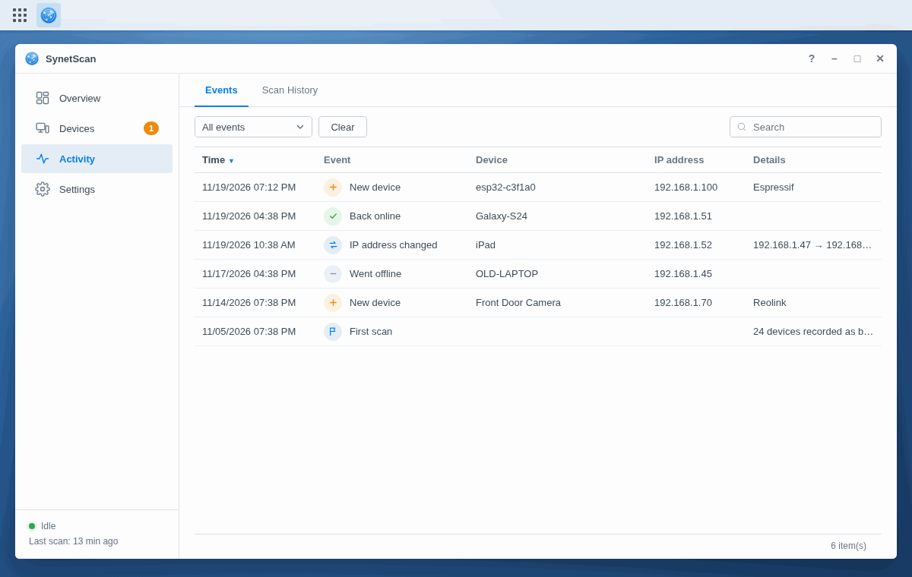
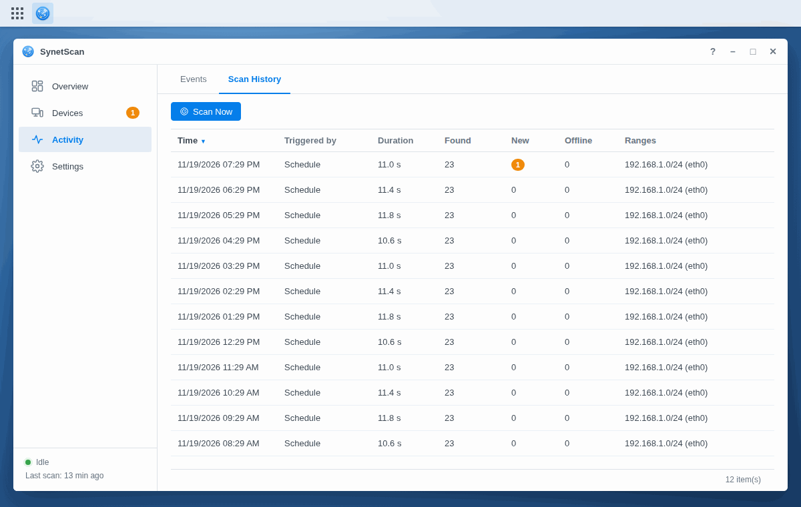

# Activity Events and Scan History

The **Activity** page has two tabs. **Events** is the log of what changed on your network. **Scan History** lists every scan with its results.

## Events

### Event types

| Event | German | Recorded when | Details column |
| --- | --- | --- | --- |
| **First scan** | Erster Scan | The first scan has filled an empty device list | *N devices recorded as baseline* |
| **New device** | Neues Gerät | A device that wasn't in the list before is found (any scan after the first) | The vendor, if known |
| **Went offline** | Offline gegangen | A device has missed as many scans as **Mark offline after** says | – |
| **Back online** | Wieder online | A device that was offline answers again | – |
| **IP address changed** | IP-Adresse geändert | A known device (same MAC address) answers under a new IPv4 address | *old → new* |

Each event stores the device's name, address and MAC address as they were at that moment. That's why an event still shows the old name after you rename a device, and still exists after you delete the device.

The first scan creates no **New device** events. Its devices are the baseline.

### Working with events

- **Filter**: *All events*, or one event type (New device, Back online, Went offline, IP address changed).
- **Search**: looks through the device name, IP address, MAC address and details.
- **Sort**: click a column header. The default is newest first.
- **Double-click** an event to open the device dialog, if the device still exists.
- **Clear**: empties the whole activity log after asking first. Devices and scan history stay.

The Overview's **Recent activity** card shows the newest seven events. **View all** opens this tab.

### How many events are kept

SynetScan keeps the **1,000 newest events**. When a new event is recorded, the oldest one beyond that limit is dropped. There is no time limit. See [Data Storage, Retention, Backup, and Reset](Data-Storage-and-Backup).

## Scan History

| Column | Meaning |
| --- | --- |
| **Time** | When the scan finished |
| **Triggered by** | **Manual** (Scan Now), **Schedule** (automatic scan) or **Service start** (the scan when the package starts). *–* for scans recorded by version 1.1.1 or older, which didn't store the trigger. |
| **Duration** | How long the scan took, in seconds |
| **Found** | Devices found in this scan |
| **New** | Devices that weren't in the list before. For the very first scan, this is every device found. |
| **Offline** | Devices that went offline with this scan |
| **Ranges** | The networks and ranges the scan covered, e.g. `192.168.1.0/24 (eth0)` |

The **Scan Now** button is on this tab too. SynetScan keeps the **100 most recent scans**. Cancelled and failed scans are not listed.

The scan history is useful for diagnosis. A scan that takes much longer than usual, or suddenly finds far fewer devices, points to a network change. If **Ranges** doesn't list the network you expect, check [Scan Targets](Scan-Targets).

## Common questions

**Why don't I see older events?** Only the newest 1,000 are kept, the log may have been cleared, or a filter or search is active. See [Troubleshooting: Older activity entries are missing](Troubleshooting#older-activity-entries-are-missing).

**Why do I get so many "Went offline / Back online" events for the same device?** The device sleeps and misses scans, which is typical for phones. Raise **Settings → Schedule → Mark offline after**. See [A phone repeatedly appears offline](Phone-Appears-Offline).

**Can SynetScan send me an e-mail or push notification for new devices?** Not at the moment. New devices are shown in the app. You can [request the feature](Reporting-Bugs).

## Related articles

- [Reviewing Newly Discovered Devices](Reviewing-New-Devices)
- [Scan Schedule and Performance](Schedule-and-Performance)
- [Data Storage, Retention, Backup, and Reset](Data-Storage-and-Backup)
