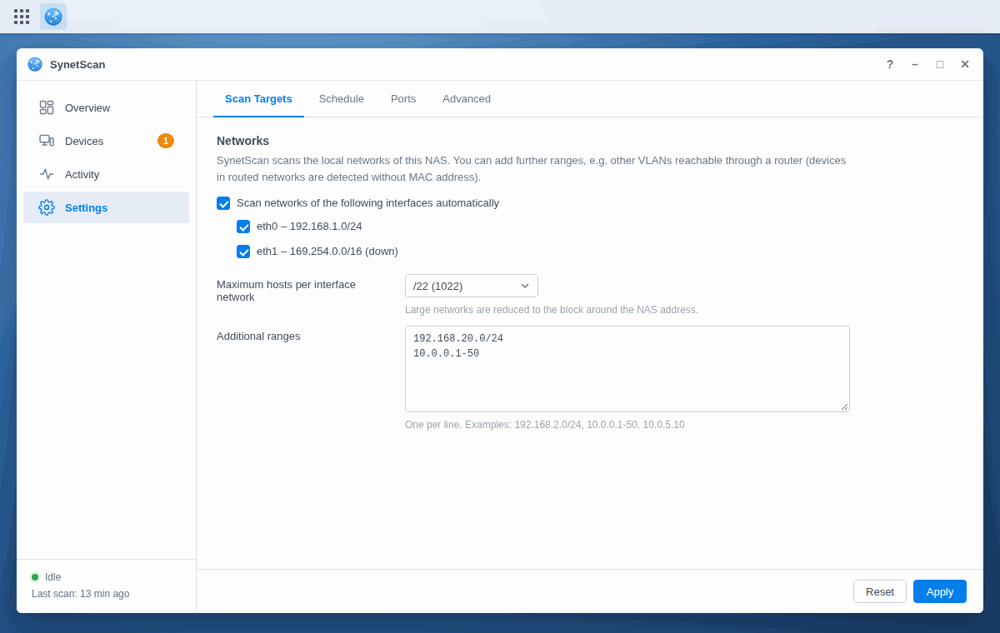

# Configuration

SynetScan works without any configuration: it scans the NAS's own networks every hour with sensible defaults. This section explains what you can change and when it's worth it.

All settings are in **Settings** (German: *Einstellungen*) on four tabs. Changes take effect when you click **Apply**. They apply from the next scan on, and a running scan keeps its old settings.

- **[Scan Targets and Custom Ranges](Scan-Targets)**: which networks are scanned, how large networks are limited, and how to add VLANs or other routed networks.
- **[Scan Schedule and Performance](Schedule-and-Performance)**: automatic scans, the interval, when a device counts as offline, timeouts and parallelism.
- **[Ports and Discovery Options](Ports-and-Discovery)**: the default port list explained port by port, and the detection methods (ping, DNS, NetBIOS, mDNS, UPnP, web titles, IPv6).
- **[Custom Port Lists for Common Situations](Custom-Port-Lists)**: ready-made port lists for home labs, Windows networks, smart homes, cameras, media servers and fast scans.
- **[Enabling ICMP Ping on DSM](Enabling-ICMP-Ping)**: why ping may be unavailable for the package and how to enable it step by step.
- **[Complete Settings Reference](Settings-Reference)**: every setting with its label, default, allowed values and effect.

