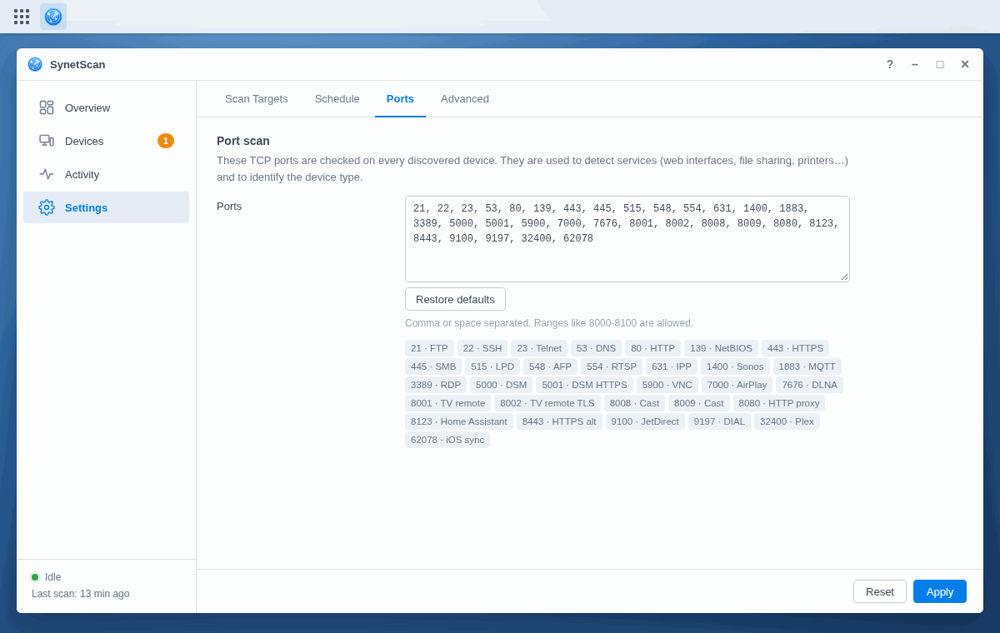

# Custom Port Lists for Common Situations

## 1. What you will achieve

SynetScan checks the ports that matter in your network: it shows more of your services, recognises servers and special devices better, or scans faster.

## 2. Prerequisites

- You have read [Ports and Discovery Options](Ports-and-Discovery), or at least know that the port list only affects identification, not whether devices are found.
- Optional: note your current list. **Restore defaults** brings back the default list at any time.

## 3. Steps

1. Open **Settings → Ports**.
2. Do one of the following:
   - **To extend the defaults**, click at the end of the **Ports** field and append the ports of a recipe below, separated by commas.
   - **To replace the list**, select everything in the field and paste a recipe.
3. Check the preview below the field: every entry should show its number, and its service name if SynetScan knows it. Red entries are invalid.
4. Click **Apply**.
5. Click **Scan Now**, or wait for the next scheduled scan.

### Recipes

Each recipe lists the ports to **add** to the defaults, unless it says *replace*. Ports SynetScan names itself are marked with their name. The others are shown by number in the app.

#### Home lab and self-hosted services

`25, 111, 2049, 3000, 3306, 5432, 6379, 8000, 8081, 8888, 9000, 9090, 9443, 10000`

SMTP, RPC, NFS, Grafana or Node.js apps ("HTTP dev"), MySQL/MariaDB, PostgreSQL, Redis, further HTTP and HTTPS ports (Portainer often uses 9443), Webmin. With 3306, 5432, 6379 or 25 open next to SSH, SynetScan types the machine as a **Server**. 9090 (often Prometheus or Cockpit) is shown by number.

#### Windows and Active Directory networks

`88, 135, 389, 1433, 5985`

Kerberos and LDAP (domain controllers), MS RPC, Microsoft SQL Server, and 5985 (WinRM, shown by number). RDP (3389), SMB (445) and NetBIOS (139) are already in the defaults. **NetBIOS names** should stay on.

#### Smart home

`80, 443, 1883, 8081, 8123, 8883` (most are defaults already, so add `8081, 8883`)

MQTT over TLS (8883) and a common second web port (8081, often used by Zigbee2MQTT front ends or ESPHome dashboards). Most smart home devices are found and named through Bonjour/mDNS, so keep **mDNS / Bonjour** on.

#### IP cameras and video recorders

`8000, 8554, 37777` (add)

Many cameras and NVRs offer RTSP on 554 (default) and a web interface on 80/443 (defaults). Some brands use extra service ports, such as 8000 on many Hikvision devices or 37777 on many Dahua devices, or alternative RTSP ports such as 8554. The exact ports depend on the model and firmware, so check your device's manual.

#### Media servers and streaming

`8096, 8200, 8920, 32469` (add)

8096/8920 are the usual HTTP/HTTPS ports of Jellyfin and Emby, 8200 that of MiniDLNA/ReadyMedia, and 32469 Plex DLNA. Plex (32400), Cast (8008/8009) and AirPlay (7000) are already in the defaults.

#### Network infrastructure (switches, access points, firewalls)

`8291, 8728, 8880` (add)

Management ports are vendor-specific: for example 8291 (Winbox) and 8728 (API) on MikroTik, or 8443 and 8880 on UniFi controllers. 22, 23, 80, 443 and 8443 are already defaults. SNMP (161) is UDP and can't be checked by the TCP port scan.

#### Security review of your own network

`21, 23, 69, 111, 135, 139, 445, 512, 513, 514, 1080, 2049, 3389, 5900, 5985, 8080`

Services that are often unwanted or unencrypted: FTP, Telnet, TFTP (UDP, so not detectable; leave it out if you like), RPC, Windows sharing, the old r-services (512–514), SOCKS proxies (1080), NFS, RDP, VNC, WinRM, HTTP proxies. Look at which devices show up with these ports, and decide whether they should.

#### Fast scan for large networks or a slow NAS (replace)

`22, 80, 443, 445, 554, 631, 1400, 5000, 5001, 8009, 8080, 9100, 62078`

Keeps the ports that matter most for types and web interfaces. Fewer ports make the identification phase faster on large networks. You lose some of the TV, AirPlay, Home Assistant and Plex recognition.

#### Developer machines

`3000-3010, 4200, 5173, 8000-8010, 8080-8090`

Typical development servers (Node.js, Angular, Vite, Django and others). Ranges are allowed: each may span up to 1,025 ports, for example `8000-9024`.

## 4. Expected result

- After the next scan, the **Services** column and the **Services** tab list the newly found ports.
- Device types may change: a Linux machine with SSH and PostgreSQL becomes a **Server**, for example. Types you set yourself never change.
- **Activity → Scan History** shows whether the scans now take noticeably longer.

## 5. Common problems

| Problem | Explanation and fix |
| --- | --- |
| **"… is not a valid port or port range."** | Ports are numbers from 1 to 65535, and a range may span up to 1,025 ports, for example `8000-9024`. Separate entries with commas or spaces. |
| **"ports: at most 2048 ports"** | The whole list may contain up to 2,048 different ports. Use smaller ranges. |
| **Scans take much longer.** | Devices that silently drop connection attempts cost up to *probe timeout + 0.3 s* for every group of 32 ports. A list of 1,000 ports means about 30 seconds per such device. Shorten the list or lower the probe timeout. |
| **A port I added doesn't show up.** | It's closed or filtered on that device, or a firewall between the NAS and the device blocks it. Check from another computer whether the service answers. UDP services can't be detected. |
| **"Open Web Interface" still ignores my port.** | The menu item only uses a fixed set of web ports, and the Services tab links a few more. See [Ports and Discovery Options](Ports-and-Discovery#choosing-your-own-port-list). |
| **I want the original list back.** | **Settings → Ports → Restore defaults**, then **Apply**. |

## 6. Related articles

- [Ports and Discovery Options](Ports-and-Discovery)
- [Scan Schedule and Performance](Schedule-and-Performance)
- [How Discovery and Identification Work](How-Discovery-Works)
- [Complete Settings Reference](Settings-Reference#ports)
