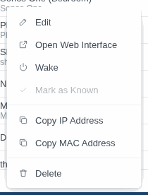
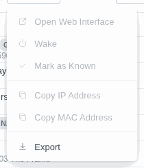
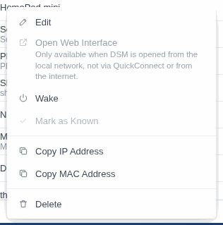

# Device Actions and CSV Export

You reach the device actions in three places:

- **Right-click** a device in the list (the context menu),
- the **Action** button in the Devices toolbar,
- the device dialog: **Wake** at the bottom left, and **Open** links on the **Services** tab.

| Context menu | Action menu |
| --- | --- |
|  |  |

## The actions

| Action | German | Needs | What it does |
| --- | --- | --- | --- |
| **Edit** | Bearbeiten | one device | Opens the device dialog |
| **Open Web Interface** | Weboberfläche öffnen | one device with a web port, local access | Opens the device's web page in a new browser tab |
| **Wake** | Aufwecken | one device with a MAC address, not the NAS | Sends a Wake-on-LAN packet |
| **Mark as Known** | Als bekannt markieren | at least one unconfirmed device | Confirms the selected devices |
| **Copy IP Address** | IP-Adresse kopieren | one device | Copies the IPv4 address, or the primary IPv6 address |
| **Copy MAC Address** | MAC-Adresse kopieren | one device with a MAC address | Copies the MAC address in upper case |
| **Delete** | Löschen | at least one device | Removes the selected devices from the list, after asking |
| **Export** (Action menu only) | Exportieren | – | Downloads all devices as a CSV file |

Items that don't apply to the current selection are greyed out.

## Open Web Interface

SynetScan opens the first web port it found on the device, in this order:

| Port | Opens |
| --- | --- |
| 443 | `https://<address>/` |
| 5001 | `https://<address>:5001/` (Synology DSM) |
| 80 | `http://<address>/` |
| 8080 | `http://<address>:8080/` |
| 5000 | `http://<address>:5000/` |
| 8443 | `https://<address>:8443/` |
| 8123 | `http://<address>:8123/` (Home Assistant) |
| 32400 | `http://<address>:32400/` (Plex) |

The **Services** tab of the device dialog has an **Open** link for every web port it knows: HTTPS for 443, 5001, 8443 and 9443, and HTTP for 80, 81, 3000, 5000, 8000, 8008, 8080, 8081, 8123, 8888, 9000 and 32400. Use it to open a port other than the first one.

The page opens in a new tab that gets no access to your DSM window and no information about where it was opened from.

**Why the item can be greyed out:**

- **Your browser isn't in the NAS's local network.** Over QuickConnect, a VPN into another subnet, or the internet, the device's local address would lead nowhere, or to a device in the network you are in. The menu then says: *Only available when DSM is opened from the local network, not via QuickConnect or from the internet.* See [Local Access, QuickConnect, VPN, and DDNS](Local-Access-QuickConnect-VPN-and-DDNS).

  

- **No web port was found.** Check the Services tab. If the device uses an unusual port, add it to the [port list](Ports-and-Discovery). The **Open** link then appears on the Services tab if the port is one of those listed above.
- **The device has only a link-local IPv6 address** (`fe80::`). Browsers can't open those.
- **More than one device is selected.**

More in [Troubleshooting: "Open web interface" is disabled](Open-Web-Interface-Disabled).

## Wake (Wake-on-LAN)

**Wake** sends a "magic packet" with the device's MAC address. SynetScan sends it as a broadcast to `255.255.255.255` and to the broadcast address of every network of the NAS, on UDP ports 9 and 7. The message *Wake-on-LAN packet sent to …* confirms that the packet was sent. It can't confirm that the device woke up. Watch its status after the next scan.

For Wake-on-LAN to work:

- Wake-on-LAN must be enabled on the device: in the BIOS/UEFI, in the network adapter's settings, or in the device's own settings.
- The device must be in one of the NAS's own networks. Broadcasts don't cross routers, so devices in [routed networks](Interfaces-VLANs-and-Routed-Networks) can't be woken this way. They have no known MAC address anyway.
- Many devices can only be woken over a cable, not over Wi-Fi.

**Wake** is greyed out for the NAS itself and for devices without a MAC address. If the service is asked to wake a device without a MAC address, it answers *The device has no known MAC address, so a Wake-on-LAN packet cannot be sent.*

## Delete

**Delete** removes the selected devices, including your names, types and notes. The confirmation says: *Delete N device(s) from the list? They will reappear as new devices when found again.*

Deleting is meant for devices that are gone for good. A device that is still on the network comes back with the next scan, as a **New** device. To keep a device but stop being reminded of it, **mark it as known** instead. There is currently no way to hide a device permanently. See [Troubleshooting: A deleted device reappears](Troubleshooting#a-deleted-device-reappears).

The device's activity events stay in the log.

Related bulk actions are in **Settings → Advanced → Data**: **Remove Offline Devices**, an automatic **Remove offline devices after** setting, and **Delete All Data**. See [Data Storage, Retention, Backup, and Reset](Data-Storage-and-Backup).

## CSV export

**Action → Export** downloads `synetscan-devices.csv` with **all** devices. The current filter and search don't apply. Devices with IPv4 come first, sorted by address, then IPv6-only devices.

| Column | Content |
| --- | --- |
| Name | Displayed name (custom or detected) |
| Status | `online` / `offline` |
| Type | Type key: `router`, `nas`, `computer`, `server`, `phone`, `tablet`, `printer`, `camera`, `media`, `speaker`, `console`, `iot`, `network`, `virtual`, `unknown` |
| IP | IPv4 address |
| IPv6 | All IPv6 addresses, separated by spaces |
| MAC | MAC address in lower case |
| Vendor | MAC vendor |
| Hostname | DNS name, else mDNS name, else NetBIOS name |
| Model | Model |
| Open ports | Port numbers, separated by spaces |
| Known | `yes` / `no` |
| First seen / Last seen | `YYYY-MM-DD HH:MM:SS` in the NAS's time zone |
| Notes | Your notes |

The file is UTF-8 with a byte order mark, so Excel recognises umlauts and other characters. Column headers and values are in English, whatever the interface language.

**Spreadsheet safety.** A device can choose its own name, and a name like `=HYPERLINK(…)` would run as a formula in a spreadsheet. SynetScan therefore puts an apostrophe in front of any cell that starts with `=`, `+`, `-`, `@`, a tab or a carriage return, so the spreadsheet shows it as text. *Available since 1.1.5.*

## Related articles

- [Interface Tour](Interface-Tour)
- [Local Access, QuickConnect, VPN, and DDNS](Local-Access-QuickConnect-VPN-and-DDNS)
- [Data Storage, Retention, Backup, and Reset](Data-Storage-and-Backup)
