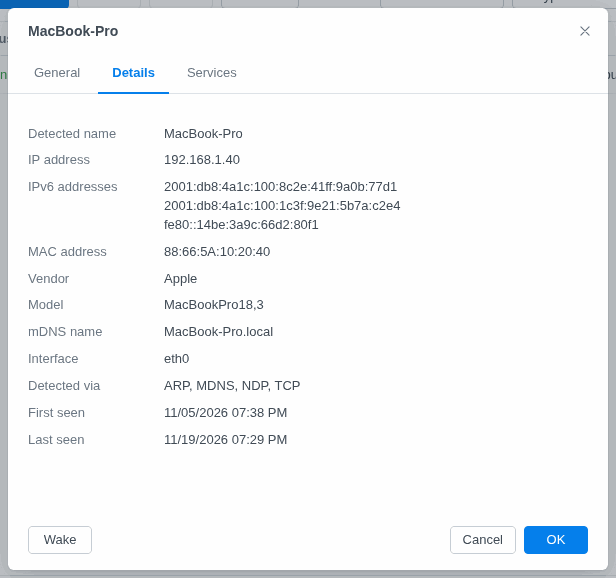

# Understanding Devices and Their Status

What SynetScan means by *Online*, *Offline*, *New* and *Unconfirmed*, how it recognises a device again, and where names and types come from.

## One device, one record

SynetScan keeps one record per device and recognises the device by its **MAC address**, the hardware address of its network adapter. When the device gets a new IP address, it stays the same record, and the activity log records **IP address changed**.

A device whose MAC address is unknown is recorded by its IP address instead. This happens with devices in [routed networks](Interfaces-VLANs-and-Routed-Networks) and with addresses a router answers for by proxy ARP. If such a device later shows its MAC address, SynetScan moves the record over to the MAC address. If its IP address changes before that, it appears as a new device.

> **Phones and tablets with private MAC addresses.** Modern phones use a randomised ("private") MAC address per Wi-Fi network. It usually stays the same for your network, but some phones can rotate it. Each new MAC address then looks like a new device. See [A phone repeatedly appears offline](Phone-Appears-Offline).

## Online and Offline

- **Online**: the device answered the most recent scan.
- **Offline**: the device has missed as many scans in a row as **Settings → Schedule → Mark offline after** says. The default is 1 missed scan.

A device only counts as "missed" if the scan actually covered its address. If you remove a range from the scan targets, its devices keep their last status instead of all going offline. An IPv6-only device counts as missed only when IPv6 discovery ran on its interface.

When a device goes offline or comes back, the activity log records **Went offline** or **Back online**. Offline devices stay in the list with their last known details until you delete them, or until **Remove offline devices after** removes them automatically ([Settings → Advanced](Settings-Reference#data)).

Devices that sleep a lot, such as phones in standby, speakers or TVs in power-saving mode, may miss a scan now and then even though they are present. If that bothers you, set **Mark offline after** to 2, 3 or 5 missed scans.

## Known, Unconfirmed and New

| Term | Meaning |
| --- | --- |
| **Known** | You have confirmed the device, or it was part of the first scan (the baseline). |
| **Unconfirmed** | Not marked as known yet. The *Unconfirmed* tile and filter show these devices, and the **Devices** navigation badge counts them. |
| **New** badge | Shown next to the name of every unconfirmed device |
| **New in 24 h** tile | Devices first seen in the last 24 hours, not counting the devices of the first scan |

The **first scan** marks every device it finds as known. That's your baseline. Each device that shows up later starts as unconfirmed with a **New** badge, until you mark it as known. See [Reviewing Newly Discovered Devices](Reviewing-New-Devices).

"Known" says nothing about trust or security. It only means you have seen and accepted the device.

## Badges

| Badge | Meaning |
| --- | --- |
| **This NAS** | The Synology NAS that runs SynetScan. A NAS with several connected ports appears once, and its other addresses are listed under **Other IP addresses** in the Details tab. |
| **Gateway** | The NAS's default gateway, usually your internet router |
| **IPv6** | The device was found over IPv6 only and has no IPv4 address. See [IPv6](IPv6). |
| **New** | Not confirmed yet |

## Device types

SynetScan sorts devices into 14 types, plus **Unknown**:

| Type (English) | German | Typical devices |
| --- | --- | --- |
| Router | Router | Internet router, the default gateway |
| NAS | NAS | Synology, QNAP, Asustor, TerraMaster, the NAS itself |
| Computer | Computer | Windows PCs, Macs, laptops |
| Server | Server | Linux machines with SSH and services, Raspberry Pi with SSH |
| Phone | Smartphone | iPhone, Android phones |
| Tablet | Tablet | iPad, Galaxy Tab, Kindle |
| Printer | Drucker | Network printers and scanners |
| Camera | Kamera | IP cameras, NVRs, video doorbells |
| TV & Media | TV & Medien | Smart TVs, Chromecast, Apple TV, Fire TV, streaming boxes |
| Speaker | Lautsprecher | Sonos, HomePod, Echo, soundbars |
| Game console | Spielkonsole | PlayStation, Xbox, Nintendo, Steam Deck |
| Smart home | Smart Home | Hue, Shelly, ESP32/Tasmota, thermostats, Home Assistant |
| Network device | Netzwerkgerät | Switches, access points, mesh nodes, powerline adapters |
| Virtual machine | Virtuelle Maschine | VMware, QEMU/Proxmox, VirtualBox, Hyper-V guests |
| Unknown | Unbekannt | Not enough information |

The type is a **guess**, made from the MAC vendor, open ports, announced services and names. For example, port 9100 or an IPP service means *Printer*, port 62078 means an Apple mobile device, and a Sonos port means *Speaker*. Devices with a private MAC address reveal no vendor, so the guess has less to go on.

If a type is wrong, set the right one in the device dialog. Your choice always wins over the automatic type, and the automatic guess stays visible as **Automatic (…)**. See [Managing Names, Types, and Notes](Names-Types-and-Notes). For how the guess works in detail, see [How Discovery and Identification Work](How-Discovery-Works#classification).

## Where the name comes from

If you haven't given a device a **Custom name**, SynetScan uses the first of these that is available and meaningful:

1. the friendly name the device announces over UPnP or Bonjour (for example "Living Room TV")
2. its mDNS/Bonjour host name (for example `MacBook-Pro.local`, shown as "MacBook-Pro")
3. its NetBIOS name (Windows and Samba)
4. its DNS name from the reverse lookup
5. for the gateway: its model
6. the vendor from the MAC address
7. the title of its web page, unless it's generic ("Login", "Welcome", "404"…)
8. its IP address, IPv6 address or MAC address

SynetScan skips names that identify nothing for a person: random service IDs, UUIDs, generic UPnP class names such as "MediaRenderer", and host names that Android makes up, such as `Android_K7QX2M4P` (ignored since 1.1.5). Local suffixes such as `.local`, `.lan`, `.fritz.box`, `.home.arpa` or `.localdomain` are removed.

**Names are claims, not proof.** Every name comes from the device itself or from your DNS, and any device on the network can announce any name. See [Security](Security-and-Privacy).

## Information that stays

A scan only overwrites what it finds again. If a device stops announcing its name, for example because it's asleep or Bonjour is off, the name from an earlier scan stays. Ports, the detection method and the response time are replaced on every scan.

The upside: devices keep their names even when they answer only briefly. The downside: outdated information can persist. To start a device's record afresh, delete it. The next scan creates it again, as a new device. See [A device has the wrong name or type](Wrong-Name-or-Type).

## The Details tab, field by field

| Field | Meaning |
| --- | --- |
| **Detected name** | The name SynetScan would use without your custom name |
| **IP address** | Current IPv4 address |
| **Other IP addresses** | Further addresses of the NAS itself (one per connected port, with the interface) |
| **IPv6 addresses** | Global addresses first, then unique-local, then link-local (`fe80::`). Outdated addresses of the NAS are marked *outdated*. |
| **MAC address** | Hardware address. *Randomised (private) MAC address* if it is a locally administered address. |
| **Reached through** | The address belongs to another device that answers for it (proxy ARP), for example a router for its VPN clients. |
| **Vendor** | Manufacturer registered for the MAC prefix (IEEE registry) |
| **Model** | From Bonjour, UPnP or the device itself |
| **DNS name / mDNS name / NetBIOS name / Workgroup** | Names found by the reverse DNS lookup, Bonjour and NetBIOS |
| **Web page** | Title and server of the device's web page |
| **UPnP device** | Manufacturer, model name and number from its UPnP description |
| **Interface** | The NAS interface the device was seen on (`eth0`, `ovs_eth0`…), or *custom* for addresses from your additional ranges |
| **Detected via** | How the device was found: ARP, TCP, ICMP, MDNS, SSDP, NDP (IPv6 neighbour table), WSD (WS-Discovery) or SELF (the NAS itself) |
| **Response time** | Ping round-trip time. Only measured when ICMP ping is available and was used for this device. See [Enabling ICMP Ping](Enabling-ICMP-Ping). |
| **First seen / Last seen** | When the device first appeared and last answered |
| **Previous IPs** | Up to five earlier IPv4 addresses |

Empty fields are left out.

## Related articles

- [Reviewing Newly Discovered Devices](Reviewing-New-Devices)
- [Managing Names, Types, and Notes](Names-Types-and-Notes)
- [How Discovery and Identification Work](How-Discovery-Works)
- [Troubleshooting](Troubleshooting)
