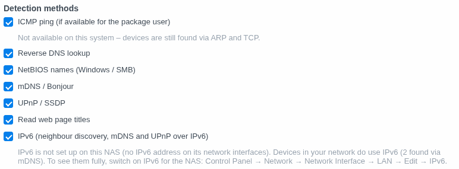

# Enabling ICMP Ping on DSM

SynetScan can use ICMP ping (echo requests, the classic `ping`), but on many NAS it isn't available to the package. Settings then shows, below **ICMP ping (if available for the package user)**:

> Not available on this system – devices are still found via ARP and TCP.



This page explains what SynetScan needs, whether you need ping at all, and how to enable it step by step.

> **Status of this guide.** The code side (what SynetScan checks and when) is exact. The DSM steps follow standard Linux and DSM tools, but haven't been verified on every DSM version. Steps marked **(to verify)** are the ones to check carefully on your system. Corrections are welcome in the [issues](https://github.com/philiphohn/synetscan/issues).

## Do you need ping?

Usually not. Without ping, SynetScan still finds every device in the NAS's own networks: each address gets connection attempts to nine common ports and a small UDP datagram, and the kernel's ARP table then lists every device that answered on the local network, even devices that block everything.

Ping adds three things:

1. **Devices in routed networks** (custom ranges behind a router) that don't answer on any of the nine discovery ports (80, 443, 22, 445, 62078, 8080, 1400, 8001, 8009) but do answer ping. There is no ARP table for routed networks, so without ping such devices stay invisible.
2. **Response time** in the device's Details tab. It is only measured by ping.
3. **IPv6**: an echo to all IPv6 devices on the link (`ff02::1`) makes devices reveal themselves. This works if unprivileged ICMP sockets are allowed (step 4 below) or the system ping works. See [IPv6](IPv6).

If you only scan the NAS's own networks and IPv6 doesn't matter to you, you can skip this page.

## What SynetScan needs

DSM 7 runs third-party packages as an unprivileged user (here: the **SynetScan** package user), and an unprivileged user can't open raw sockets. SynetScan therefore doesn't send ICMP itself for IPv4. It runs the system's `ping` program:

1. It looks for an executable at `/bin/ping`, `/usr/bin/ping`, `/sbin/ping` and `/usr/sbin/ping`.
2. It runs `ping -c 1 -W 1 127.0.0.1` **as the package user**. If that succeeds, ping counts as available.
3. The result is checked **once per service start** and remembered. **After changing anything, restart the package.**

A non-root user can ping on Linux in one of two ways:

- **The ping program has extra privileges**: it is setuid root, or has the `cap_net_raw` file capability. That's a property of the binary.
- **ICMP datagram ("ping") sockets are allowed for the user's group.** The kernel setting `net.ipv4.ping_group_range` lists the group IDs that may open them. The default `1 0` (an empty range) allows no group. Ping programs that support these sockets (recent iputils, for example) then work without privileges.

On the three test systems (DSM 7.1.1 and 7.4.1), `net.ipv4.ping_group_range` was `1 0`. SynetScan's own IPv6 echo uses ICMPv6 datagram sockets, which the same kernel setting controls.

**What SynetScan never asks you to do:** run the package as root, make `ping` setuid, or switch off the DSM firewall. None of these is necessary. They weaken the NAS's security, and DSM updates may undo changes to system files.

## 1. What you will achieve

The hint *Not available on this system* disappears from **Settings → Advanced**, scans ping addresses that don't answer otherwise, and the setting survives reboots.

## 2. Prerequisites

- An administrator account and SSH access to the NAS. Enable SSH in **Control Panel → Terminal & SNMP → Terminal → Enable SSH service** **(to verify for your DSM version)**. You can switch it off again afterwards.
- An SSH client: Terminal on macOS and Linux, Windows Terminal or PowerShell on Windows (`ssh` is built in).
- SynetScan installed and running.

## 3. Steps

### Step 1: Check the current state in SynetScan

Open **Settings → Advanced**. If there is no hint under **ICMP ping**, ping already works and you are done. Otherwise continue.

### Step 2: Sign in over SSH and become root

```sh
ssh your-admin-user@192.168.1.10        # your NAS's address
sudo -i                                  # enter your password again
```

### Step 3: Collect the facts

```sh
# the package user and its group (owner of SynetScan's data files)
stat -c 'user=%U group=%G gid=%g' /var/packages/SynetScan/var/config.json

# who may open ICMP datagram sockets ("1 0" means nobody)
cat /proc/sys/net/ipv4/ping_group_range

# which ping programs exist, and whether they carry the setuid bit ("s" in -rwsr-xr-x)
ls -l /bin/ping /usr/bin/ping /sbin/ping /usr/sbin/ping 2>/dev/null

# the test SynetScan runs, as the package user
sudo -u SynetScan /bin/ping -c 1 -W 1 127.0.0.1; echo "exit code: $?"
```

Note the **gid** number from the first command. The rest of this guide calls it `GID`. If the user name in the last command is different on your system, use the one `stat` printed. If `/bin/ping` doesn't exist, use the path `ls` found. The `sudo -u` test **(to verify on DSM)** should reproduce SynetScan's own check: exit code 0 means ping works for the package user.

### Step 4: Allow ICMP datagram sockets for the package's group

Allow exactly the package's group, nothing else (replace `GID` with your number, twice):

```sh
sysctl -w net.ipv4.ping_group_range="GID GID"
cat /proc/sys/net/ipv4/ping_group_range                 # should now show GID GID
sudo -u SynetScan /bin/ping -c 1 -W 1 127.0.0.1; echo "exit code: $?"
```

- **Exit code 0**: the system ping now works for SynetScan. Continue with step 5.
- **Still an error**: this ping program doesn't support ICMP datagram sockets. SynetScan's IPv4 ping stays unavailable, which is fine, because devices are still found via ARP and TCP. SynetScan's own **IPv6** echo does benefit from the setting. Decide whether to keep it for IPv6 (continue with step 5) or undo it:

  ```sh
  sysctl -w net.ipv4.ping_group_range="1 0"
  ```

This setting is narrow. It lets members of one group send ICMP echo requests and receive the replies. It doesn't grant raw sockets or any other privilege. Some Linux distributions allow it for all users by default (range `0 2147483647`), but a single group is enough here.

### Step 5: Restart SynetScan

SynetScan checks ping once per service start, so restart it: in **Package Center**, open SynetScan, click **Stop**, then **Run**.

<!-- SCREENSHOT TODO: Package Center → SynetScan → Stop / Run buttons -->

Open **Settings → Advanced** again. The hint below **ICMP ping** should be gone.

### Step 6: Make it permanent with a boot-up task

`sysctl -w` lasts until the next reboot. To apply it at every boot, create a triggered task **(to verify: menu names and the `synopkg` command on your DSM version)**:

1. Open **Control Panel → Task Scheduler**.
2. Click **Create → Triggered Task → User-defined script**.
3. **General** tab:
   - **Task**: `SynetScan ping`
   - **User**: `root`
   - **Event**: `Boot-up`
   - **Enabled**: ticked
4. **Task Settings** tab, **Run command → User-defined script** (replace `GID`):

   ```sh
   sysctl -w net.ipv4.ping_group_range="GID GID"
   # SynetScan checks ping when its service starts; restart it in case it started first
   sleep 10
   /usr/syno/bin/synopkg restart SynetScan
   ```

5. Click **OK** and confirm the warning about running scripts as root.
6. To test it, select the task and click **Run**. Then check **Settings → Advanced** in SynetScan.

<!-- SCREENSHOT TODO: Task Scheduler → Create → Triggered Task → User-defined script (General tab: user root, event Boot-up) -->
<!-- SCREENSHOT TODO: Task Scheduler → Task Settings tab with the script -->

If `synopkg restart` doesn't exist on your DSM version, use `synopkg stop SynetScan` followed by `synopkg start SynetScan`.

### Step 7: Check the result after a scan

Run **Scan Now**. Then:

- In the [log](Logs-and-Diagnostics), the scan's first line ends with `ping=True`: `scan started: 254 targets (192.168.1.0/24 (eth0)), ping=True`.
- Devices that answered ping but no TCP port show **ICMP** under **Detected via**, with a **Response time**.
- With IPv6 on, the IPv6 log line shows how the all-nodes echo was sent: `echo: socket` (SynetScan's own ICMPv6 socket) or `echo: ping` (the system ping) instead of `echo: none`.

## 4. Expected result

- **Settings → Advanced** shows no *Not available on this system* hint.
- Scans of routed ranges also find hosts that only answer ping.
- After a reboot, ping is still available.

## 5. Common problems

| Problem | Explanation and fix |
| --- | --- |
| **The hint is still there after step 4.** | SynetScan hasn't been restarted (step 5), or this ping program doesn't support datagram sockets (see step 4). |
| **It worked, but after a reboot the hint is back.** | The boot-up task is missing or failed, or SynetScan started before the task and wasn't restarted. Run the task manually and check its result in Task Scheduler. |
| **Devices still don't answer ping.** | Many devices ignore ping on purpose. Windows blocks incoming echo requests in its firewall unless the rule *File and Printer Sharing (Echo Request - ICMPv4-In)* is enabled. Phones in standby rarely answer. That's why SynetScan doesn't depend on ping. |
| **Routed devices don't answer ping.** | The router or firewall between the networks has to allow ICMP echo requests from the NAS to that network, and the replies back. |
| **The DSM firewall is on.** | Replies to requests the NAS sent itself are normally let through **(to verify for the DSM firewall)**. If you use a profile with a final *Deny* rule, add a rule above it that allows all traffic from your local network: **Control Panel → Security → Firewall → Edit Rules → Create**, Ports: *All*, Source IP: *Specific IP → Subnet* (e.g. `192.168.1.0` / `255.255.255.0`), Action: *Allow* **(to verify)**. This also helps mDNS and UPnP answers, which arrive as separate packets from the devices. |
| **`sudo -u SynetScan` says the user doesn't exist.** | Use the user name `stat` printed in step 3. |
| **I'd rather not change kernel settings.** | Leave ping off. SynetScan finds local devices via ARP and TCP. For routed networks, make sure the devices answer on one of the discovery ports, or accept that some won't be found. |

### What not to do

- **Don't make `ping` setuid** (`chmod u+s`). It changes a system file, DSM updates may undo it, and it gives a root-owned program to every user.
- **Don't try to run SynetScan as root.** DSM 7 doesn't allow it for third-party packages, and SynetScan is built not to need it.
- **Don't switch off the DSM firewall** to make ping work. Add a specific *Allow* rule instead.

## 6. Related articles

- [Ports and Discovery Options](Ports-and-Discovery)
- [IPv6 Discovery and Addresses](IPv6)
- [Multiple Interfaces, VLANs, and Routed Networks](Interfaces-VLANs-and-Routed-Networks)
- [Logs and Diagnostics](Logs-and-Diagnostics)
- [DSM Permissions, Security, and Privacy](Security-and-Privacy)
