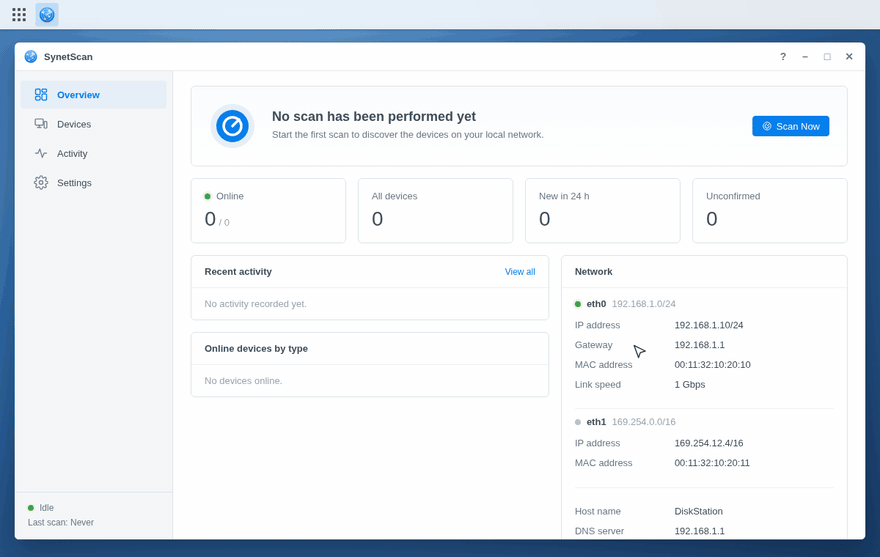
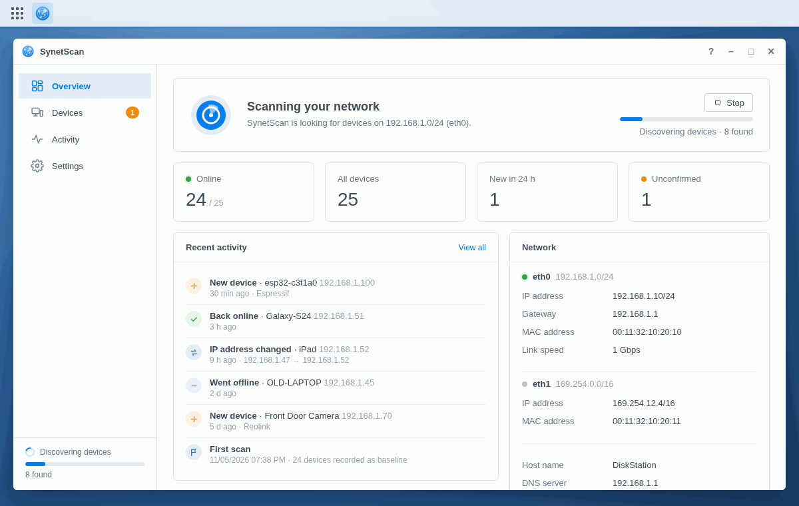
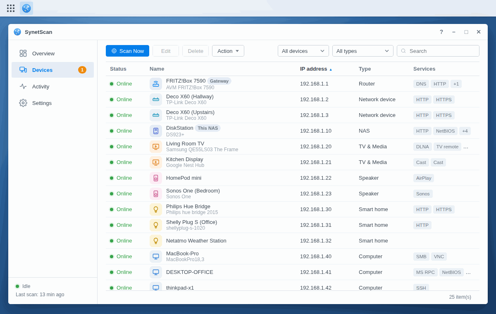

# Quick Start: Your First Scan

## 1. What you will achieve

You run a first scan, see every device on your network, and understand the **baseline**: the devices of the first scan are your "known" devices. Every device that shows up later is flagged as **New**.

## 2. Prerequisites

- SynetScan is [installed](Installation) and **Running** in Package Center.
- You are signed in to DSM as an administrator.

## 3. Steps

### Step 1: Open SynetScan

Open SynetScan from the DSM main menu. The **Overview** page opens.

When the package service starts, it runs a scan on its own. Depending on how quickly you opened the app, you see one of these:

- **Scanning your network**: the first scan is running. Wait for it to finish (Step 3).
- **No scan has been performed yet**: no scan has run yet. Continue with Step 2.
- A device list or **Your network looks fine**: the first scan has already finished.

### Step 2: Start a scan

Click **Scan Now** (German: *Jetzt scannen*). You can start a scan from the Overview, the Devices page and the Scan History tab.

### Step 3: Follow the progress

The banner and the status area in the bottom left show the current phase:

| Phase | What happens |
| --- | --- |
| **Preparing** | SynetScan reads the NAS's network interfaces and works out which addresses to scan. |
| **Discovering devices** | Every address gets a few quick connection attempts, and the NAS listens for Bonjour/mDNS and UPnP announcements. |
| **Identifying devices** | Each device found is examined: open ports, host names, UPnP description, web page title, MAC vendor. |
| **Verifying** | Devices that were only in the ARP cache are checked again, so that devices that have just left are not reported as online. |

A /24 network (254 addresses) usually takes about 8 to 15 seconds. To stop a running scan, click **Stop**. A stopped scan changes nothing in the device list.

### Step 4: Look at the result

When the scan has finished, a message such as *Scan finished: 24 devices found, 24 new.* appears and the Overview updates. For the first scan, every device counts as "new" in this message and in the **New** column of the scan history, because the device list was empty before. The devices themselves are still recorded as known:

- The banner says **Your network looks fine**: all devices are online and known.
- **Online**, **All devices**, **New in 24 h** and **Unconfirmed** show the counts.
- **Recent activity** shows a **First scan** entry: *24 devices recorded as baseline*.
- **Online devices by type** groups the devices into routers, computers, phones, TVs and so on.

Click **Devices** in the navigation to see the full list.

## 4. Expected result

- The device list shows your router (with a **Gateway** badge), the NAS itself (**This NAS**) and every other device that was switched on.
- All devices from this first scan count as **known**. None of them has a **New** badge.
- The next scan runs automatically in an hour, the default interval. The banner shows *Next scan: in … min*.

### What the baseline means

The first scan defines what "normal" looks like. SynetScan marks every device of the first scan as known, so you don't have to confirm 30 devices one by one. From the second scan on:

- a device that wasn't there before is added with a **New** badge, counts as **Unconfirmed**, and creates a **New device** event in the activity log;
- you confirm it with **Mark as Known** once you know what it is. See [Reviewing Newly Discovered Devices](Reviewing-New-Devices).

If an unfamiliar device was already on the network during the first scan, it is part of the baseline too. It's worth going through the list once and checking that you recognise each device.

## 5. Common problems

| Problem | What to do |
| --- | --- |
| **Devices are missing.** | Devices that are switched off or asleep can't be found. Phones in standby often answer late. Check again after the next scan, and see [A device or part of my subnet is missing](Missing-Devices). |
| **Only the NAS and the router were found.** | Check **Settings → Scan Targets**: is the right interface ticked? See [Scan Targets](Scan-Targets). |
| **A device has a strange name or the wrong type.** | Give it your own name and type. See [Managing Names, Types, and Notes](Names-Types-and-Notes). |
| **Many devices show "Private address" instead of a vendor.** | Those are phones, tablets and laptops that use randomised MAC addresses. See [A device has no MAC address or vendor](No-MAC-or-Vendor). |
| **The scan takes much longer than 15 seconds.** | Large or several networks take longer. See [Scan Schedule and Performance](Schedule-and-Performance). |

## 6. Related articles

- [Interface Tour](Interface-Tour)
- [Understanding Devices and Their Status](Devices-and-Status)
- [Reviewing Newly Discovered Devices](Reviewing-New-Devices)
- [How Discovery and Identification Work](How-Discovery-Works)
