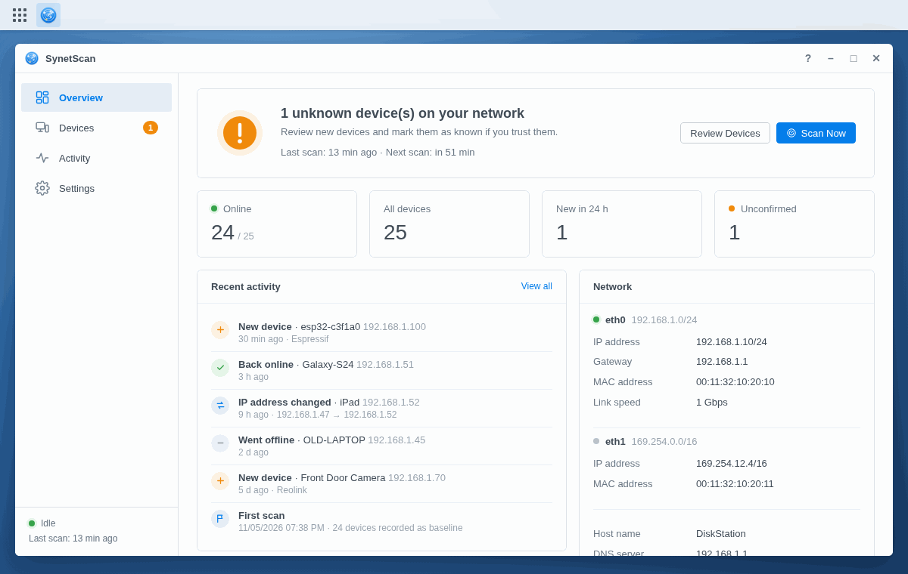

# SynetScan Wiki

**SynetScan is a network scanner for your Synology NAS.** It finds every device on your local network, works out what each one is, and flags any device it has not seen before. It runs as a regular DSM 7 package with DSM's own look. It needs no Docker, no cloud account and no command line.

All screenshots in this wiki come from the local preview with made-up devices and addresses.

## Start here

| | |
| --- | --- |
| 📦 **[Install SynetScan](Installation)** | Download the package and install it with Package Center. |
| 🔍 **[Run your first scan](First-Scan)** | Open the app, start a scan and set the baseline of known devices. |
| 🧭 **[Understand your devices](Devices-and-Status)** | What *Online*, *New*, *Unconfirmed* and the device types mean. |
| 🛠 **[Solve a problem](Troubleshooting)** | Missing devices, wrong names, phones that keep going offline and more. |

**Download:** [latest release](https://github.com/philiphohn/synetscan/releases/latest) · **Release notes:** [GitHub Releases](https://github.com/philiphohn/synetscan/releases) · **Report a problem:** [GitHub Issues](https://github.com/philiphohn/synetscan/issues) ([how to](Reporting-Bugs)) · **Website:** [synetscan.hbc-berlin.com](https://synetscan.hbc-berlin.com/en/)

## Compatibility at a glance

| | |
| --- | --- |
| DSM | 7.0 or newer (DSM 6 is not supported) |
| Models | Every model: the package is `noarch` and contains no compiled code |
| Python | The Python 3 that DSM 7 ships (3.8). Python 3.6 or newer works |
| Tested on | DS220+ (DSM 7.4.1), DS923+ (DSM 7.4.1), DS1813+ (DSM 7.1.1) |
| Users | Only members of the DSM **administrators** group |
| Languages | English and German. The app follows your DSM language |
| License | GNU GPL v3 or later |

For the details, see [Requirements and Compatibility](Requirements-and-Compatibility).

## What SynetScan does

- **Finds everything on your LAN.** That includes devices that ignore ping and block every port, because SynetScan also reads the NAS's ARP table.
- **Identifies devices.** It combines the MAC vendor, host names (DNS, NetBIOS, mDNS/Bonjour), UPnP descriptions, open services and web page titles, and sorts devices into 14 types.
- **Flags new devices.** The first scan becomes your baseline. Any device that joins later is marked **New** until you confirm it.
- **Keeps a history.** The activity log records new devices, devices going offline or coming back, and IP address changes.
- **Speaks IPv6.** It shows IPv6 addresses and finds devices that have no IPv4 address at all.
- **Runs on its own** on a schedule, from every 5 minutes to once a day.

Why run a scanner on the NAS at all? See [Network Scanning Basics](Network-Scanning-Basics).

## Full documentation

**[Getting Started](Getting-Started)**
- [Requirements and Compatibility](Requirements-and-Compatibility)
- [Installing SynetScan](Installation)
- [Quick Start: Your First Scan](First-Scan)

**[Using SynetScan](Using-SynetScan)**
- [Interface Tour](Interface-Tour)
- [Understanding Devices and Their Status](Devices-and-Status)
- [Reviewing Newly Discovered Devices](Reviewing-New-Devices)
- [Managing Names, Types, and Notes](Names-Types-and-Notes)
- [Activity Events and Scan History](Activity-and-Scan-History)
- [Device Actions and CSV Export](Device-Actions-and-CSV-Export)

**[Configuration](Configuration)**
- [Scan Targets and Custom Ranges](Scan-Targets)
- [Scan Schedule and Performance](Schedule-and-Performance)
- [Ports and Discovery Options](Ports-and-Discovery)
- [Custom Port Lists for Common Situations](Custom-Port-Lists)
- [Enabling ICMP Ping on DSM](Enabling-ICMP-Ping)
- [Complete Settings Reference](Settings-Reference)

**[Networking Explained](Networking-Explained)**
- [Network Scanning Basics](Network-Scanning-Basics)
- [How Discovery and Identification Work](How-Discovery-Works)
- [IPv6 Discovery and Addresses](IPv6)
- [Multiple Interfaces, VLANs, and Routed Networks](Interfaces-VLANs-and-Routed-Networks)
- [Local Access, QuickConnect, VPN, and DDNS](Local-Access-QuickConnect-VPN-and-DDNS)

**[Administration](Administration)**
- [Updating and Uninstalling](Updating-and-Uninstalling)
- [DSM Permissions, Security, and Privacy](Security-and-Privacy)
- [Data Storage, Retention, Backup, and Reset](Data-Storage-and-Backup)
- [Logs and Diagnostics](Logs-and-Diagnostics)

**[Help](Help)**
- [Troubleshooting](Troubleshooting)
- [Frequently Asked Questions and Known Limitations](FAQ)
- [Reporting Bugs and Requesting Features](Reporting-Bugs)

**[Development](Development)**
- [Architecture and DSM Integration](Architecture)
- [Local Development and Testing](Local-Development)
- [Building Packages and Publishing Releases](Building-and-Releasing)
- [Internal API and Data Formats](Internal-API)
- [Contributing, Translations, and Vendor Database](Contributing)
