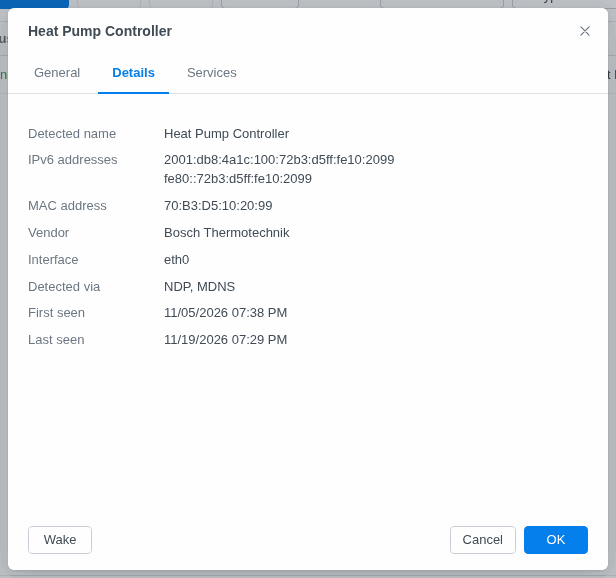

# IPv6 Discovery and Addresses

SynetScan shows each device's IPv6 addresses, and finds devices that have no IPv4 address at all. This page explains how that works without root privileges, what the IPv6 hints in Settings mean, and what IPv6 can't do.

**Setting:** **Settings → Advanced → IPv6 (neighbour discovery, mDNS and UPnP over IPv6)**, on by default.

## Why IPv6 is different

An IPv4 home network has 254 addresses, which SynetScan can simply try one by one. An IPv6 network (a /64) has 18,446,744,073,709,551,616 addresses. Trying them all is impossible. On top of that, the usual IPv6 tool (ICMPv6 neighbour discovery and echo) needs raw sockets, which an unprivileged package can't open.

So SynetScan makes the devices talk, and then reads what the NAS's kernel has learned about them.

## How SynetScan finds IPv6 devices

IPv6 discovery runs in the background while the IPv4 devices are being identified, on every physical interface that is up and has an IPv6 link-local address. Unticked interfaces are left out.

1. **Multicast queries** to the IPv6 groups of three discovery protocols:
   - **mDNS/Bonjour** to `ff02::fb` (if *mDNS / Bonjour* is on)
   - **SSDP/UPnP** to `ff02::c` (if *UPnP / SSDP* is on)
   - **WS-Discovery** to `ff02::c` port 3702 (Windows PCs, printers, scanners, many NAS)

   They are sent from the link-local address and also from a routable address of the NAS. Devices answer from an address of the same kind, so the answers also reveal their routable (global or unique-local) addresses.
2. **An echo to all nodes** (`ff02::1`), from each of the NAS's addresses, through an unprivileged ICMPv6 socket. If the system doesn't allow such sockets, the system `ping` is used if it works for the package user. Where neither is available, this step is skipped. See [Enabling ICMP Ping](Enabling-ICMP-Ping).
3. **A datagram to the EUI-64 link-local address** of every MAC address already known from IPv4. Many embedded devices derive their `fe80::` address from their MAC address. Private MAC addresses are skipped, because their IPv6 addresses aren't derived from the MAC.
4. After a two-second pause, SynetScan reads the kernel's **IPv6 neighbour table**, through netlink or, if that fails, `ip -6 neigh`. Neither needs privileges. Every device that answered, or that contacted the NAS, is in it with its MAC address.

### From addresses to devices

- Addresses are **grouped by MAC address**. Phones and PCs often use several IPv6 addresses at once, including temporary privacy addresses that change daily. Grouped by MAC, they stay one device.
- Addresses of devices already found over IPv4 are added to those devices. Detected via then includes **NDP**.
- Devices with IPv6 but no IPv4 address become devices of their own, with an **IPv6** badge. They are port-scanned and identified (reverse DNS, mDNS, WS-Discovery, UPnP, web title) like any other device.
- Addresses a device announces for its `.local` name over mDNS are added too, if they belong to the interface's current prefixes.
- **Stale prefixes are filtered out.** The kernel keeps neighbour entries from earlier provider prefixes for a long time. SynetScan only keeps routable addresses inside the NAS's current prefixes, plus link-local addresses. If the NAS has no routable prefix, everything is kept.
- **Sorting**: global addresses first, then unique-local (`fc00::/7`), then link-local (`fe80::`).
- The NAS's own outdated (deprecated) addresses are marked *outdated* in the Overview and the Details tab.

## The IPv6 hint in Settings

**Settings → Advanced** shows what the last scan found, below the IPv6 option:

| Hint | Meaning | What to do |
| --- | --- | --- |
| *Last scan: N device(s) with IPv6, M of them over IPv6 only.* | IPv6 works and your network hands out a routable prefix. | Nothing |
| *Only link-local IPv6 (fe80::) in this network – it hands out no IPv6 prefix. Last scan: N device(s) with IPv6.* | The NAS has IPv6 on, but your router doesn't hand out an IPv6 prefix. Devices are found by link-local address only. | Nothing, or enable IPv6 on your router if your provider offers it |
| *IPv6 is not set up on this NAS (no IPv6 address on its network interfaces).* | IPv6 is off on the NAS, so SynetScan can't use it. | See below |
| … *Devices in your network do use IPv6 (N found via mDNS). To see them fully, switch on IPv6 for the NAS: Control Panel → Network → Network Interface → LAN → Edit → IPv6.* | Added when devices announced IPv6 addresses over mDNS although the NAS has IPv6 off | Switch on IPv6 on the NAS, if you want |
| *IPv6 discovery failed in the last scan: …* | An error. IPv4 results are never affected. | Check the [log](Logs-and-Diagnostics) and [report it](Reporting-Bugs) |

### Switching on IPv6 on the NAS

In DSM: **Control Panel → Network → Network Interface**, select the LAN interface, **Edit → IPv6**, and choose automatic configuration **(to verify: the exact option names differ between DSM versions)**. Changing network settings can briefly interrupt the NAS's connection. Do it when nobody is using the NAS.

<!-- SCREENSHOT TODO: Control Panel → Network → Network Interface → LAN → Edit → IPv6 tab -->

## What the Overview shows

The **Network** card lists the NAS's routable IPv6 addresses per interface, with their prefix length. Link-local addresses aren't listed there.

## Limits of IPv6 discovery

- **IPv6-only devices need to answer something.** SynetScan finds IPv6-only devices that answer mDNS, UPnP or WS-Discovery, that talk to the NAS anyway, or (where the system allows unprivileged ping) that answer an echo to all nodes. A device that does none of these stays invisible over IPv6. Most home devices also use IPv4, and the IPv4 scan finds them regardless.
- **Web interfaces of link-local-only devices can't be opened.** Browsers can't open `fe80::` addresses. **Open Web Interface** needs a global or unique-local address.
- **Routed IPv6 networks** aren't scanned. IPv6 discovery covers the NAS's own links only.
- **Privacy addresses change.** A phone's temporary addresses come and go. The list shows the addresses seen in recent scans.
- **Not every IPv6 address of a device may be shown**: a device may simply not use all of them while SynetScan is looking.

### Offline status of IPv6-only devices

An IPv6-only device only counts as having missed a scan if IPv6 discovery actually ran on its interface. If you switch IPv6 off or untick its interface, it keeps its last status.

## Tested setups

IPv6 was tested on three networks: native IPv6 from the provider with Open vSwitch on the NAS (DS1813+, DSM 7.1.1), link-local IPv6 only (DS923+, DSM 7.4.1), and IPv6 off on the NAS (DS220+, DSM 7.4.1). On all three, unprivileged ICMP sockets were not allowed (`net.ipv4.ping_group_range` = `1 0`). There, the all-nodes echo depends on whether the system ping works for the package user. The other methods work regardless.

## Related articles

- [How Discovery and Identification Work](How-Discovery-Works)
- [Enabling ICMP Ping on DSM](Enabling-ICMP-Ping)
- [Multiple Interfaces, VLANs, and Routed Networks](Interfaces-VLANs-and-Routed-Networks)
- [FAQ and Known Limitations](FAQ)
