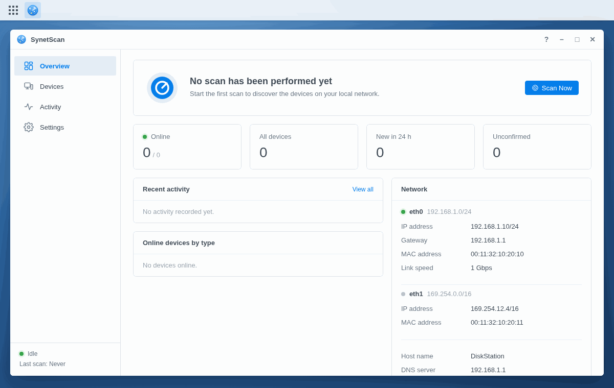

# Installing SynetScan

## 1. What you will achieve

SynetScan is installed on your Synology NAS, its background service is running, and the app is in the DSM main menu. A first scan starts automatically when the service starts.

## 2. Prerequisites

- A Synology NAS with **DSM 7.0 or newer** ([details](Requirements-and-Compatibility)).
- A DSM account in the **administrators** group.
- A computer with a browser, signed in to DSM.

## 3. Steps

### Step 1: Download the package

1. Open the [latest release](https://github.com/philiphohn/synetscan/releases/latest) on GitHub.
2. Under **Assets**, download `SynetScan-<version>-noarch.spk`, for example `SynetScan-1.1.2-0001-noarch.spk`.

There is only one file for all models: `noarch` means it runs on every CPU. Don't unpack it. DSM installs the `.spk` file as it is.

> You can also build the package yourself from the source code with `./build.sh`. See [Building Packages and Publishing Releases](Building-and-Releasing).

### Step 2: Open Manual Install in Package Center

1. In DSM, open **Package Center**.
2. Click **Manual Install** (top right).
3. Click **Browse**, choose the downloaded `.spk` file and click **Next**.

<!-- SCREENSHOT TODO: Package Center → Manual Install dialog with the SynetScan .spk selected -->

### Step 3: Confirm the publisher warning

SynetScan is not signed by Synology, so DSM warns that the package comes from an **unknown publisher**. This is expected for packages that are not in Synology's own catalogue. Confirm to continue.

<!-- SCREENSHOT TODO: DSM warning "unknown publisher" for SynetScan -->

> **To verify on your DSM version:** if DSM refuses the package instead of showing a warning, check the trust level in **Package Center → Settings → General**. It must allow packages from publishers other than Synology.

### Step 4: Finish the wizard

1. DSM shows a summary with the package name, version and description. Click **Done** (or **Apply**, depending on the DSM version) to install.
2. Leave **Run after installation** switched on if DSM offers it.

During installation, SynetScan checks that Python 3.6 or newer is available. If it isn't, Package Center shows:

> SynetScan requires Python 3. Please install "Python 3.9" from Package Center and try again.

Install **Python 3.9** from Package Center and repeat Step 2.

<!-- SCREENSHOT TODO: Package Center showing SynetScan installed and "Running" -->

### Step 5: Open SynetScan

1. Open the DSM **main menu** (the grid icon in the top left corner).
2. Click **SynetScan**. You can also click **Open** next to SynetScan in Package Center.

SynetScan opens as a normal DSM window.

<!-- SCREENSHOT TODO: DSM main menu with the SynetScan icon -->

If the app doesn't appear in the main menu yet, reload the DSM page in your browser (F5).

## 4. Expected result

- Package Center lists **SynetScan** as **Running**.
- The DSM main menu has a **SynetScan** entry. Only administrators see it.
- In SynetScan, the Overview shows **Scanning your network** for about 10 to 20 seconds, then the devices it found. When the service starts, it runs the first scan on its own. You can also start one with **Scan Now**. Continue with [Your First Scan](First-Scan).

## 5. Common problems

| Problem | What to do |
| --- | --- |
| **Manual Install does nothing the first time.** | In testing over QuickConnect, a first attempt sometimes did nothing and a second one worked. This happens in DSM before the package's own scripts run. Try again, or install while connected to DSM in the local network. |
| **"SynetScan requires Python 3…"** | Install **Python 3.9** from Package Center, then install SynetScan again. |
| **"SynetScan requires Python 3.6 or newer (found: …)"** | An old Python was found first. Install **Python 3.9** from Package Center. It is the first location SynetScan checks. |
| **"SynetScan service failed to start, see …/synetscan.log"** | The service did not come up within 10 seconds. Read the log ([how](Logs-and-Diagnostics)) and [report the problem](Reporting-Bugs). |
| **SynetScan isn't in the main menu.** | Reload the DSM page (F5). Only members of the administrators group see the entry. |
| **The app says it has to be opened from the DSM main menu.** | You opened `index.html` in a browser tab of its own. Click **Open in DSM**, or open SynetScan from the main menu. |
| **"The SynetScan service is not running"** | Start the package in Package Center (**Run**). |

More: [Troubleshooting](Troubleshooting).

## 6. Related articles

- [Quick Start: Your First Scan](First-Scan)
- [Updating and Uninstalling](Updating-and-Uninstalling)
- [DSM Permissions, Security, and Privacy](Security-and-Privacy)
- [Requirements and Compatibility](Requirements-and-Compatibility)
