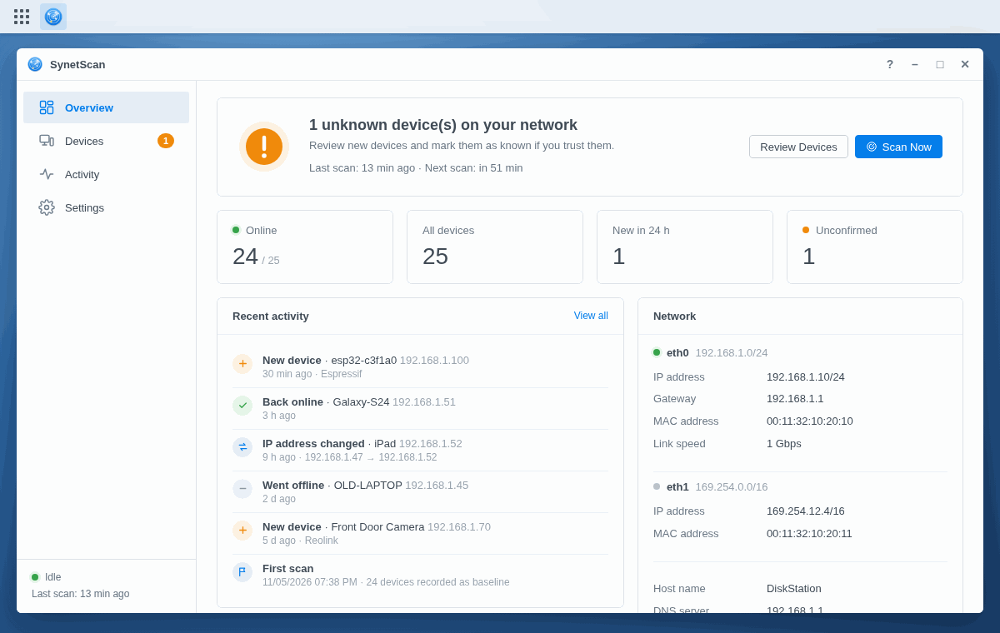
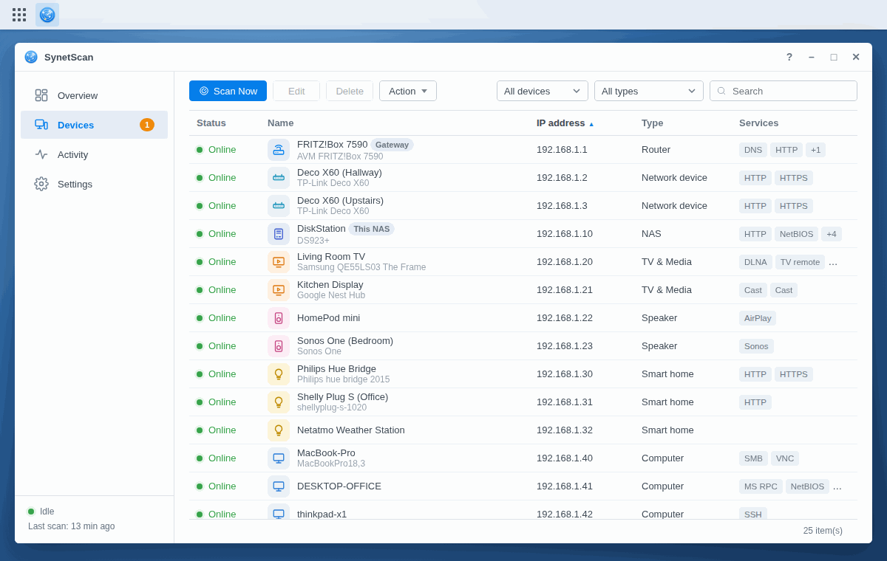
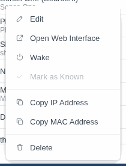
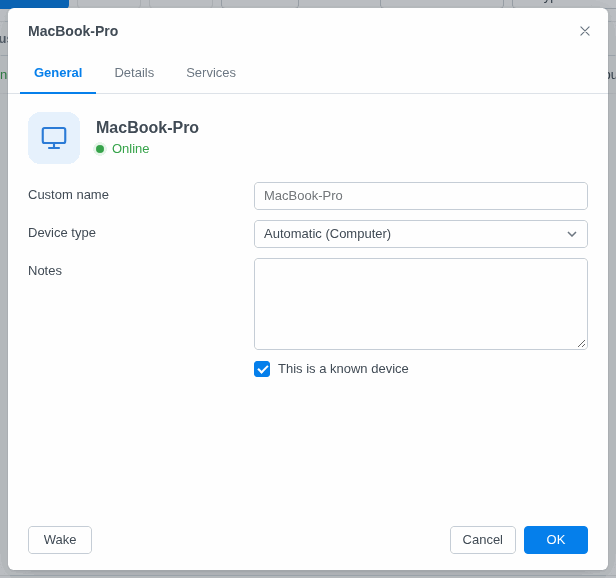
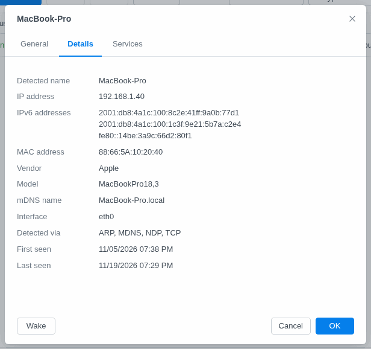
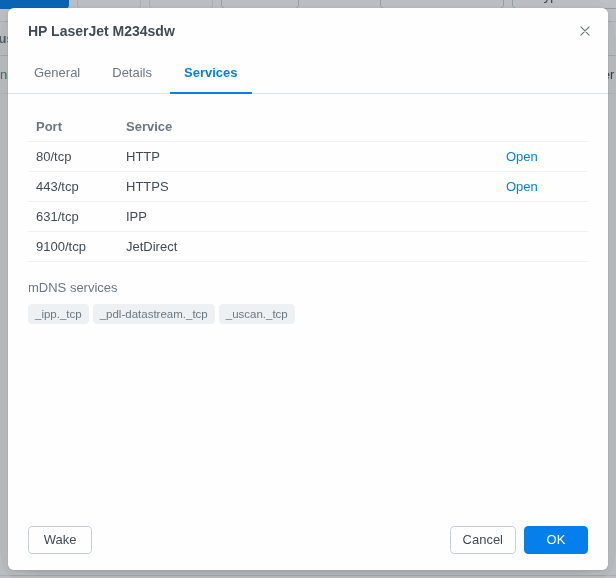
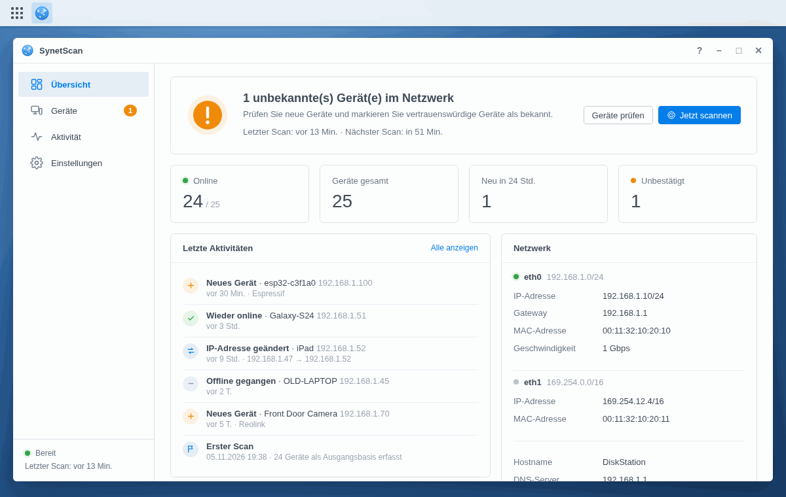

# Interface Tour

SynetScan opens as a normal DSM window. On the left are four pages: **Overview**, **Devices**, **Activity** and **Settings** (German: *Übersicht*, *Geräte*, *Aktivität*, *Einstellungen*). Below them is a status area that always shows what the scanner is doing.

The app follows your DSM language: German if DSM is set to German, English otherwise. Times are shown in the NAS's time zone, the same way DSM shows them.

## Navigation and status area

- **Devices** carries an orange badge with the number of **unconfirmed** devices: those you haven't marked as known yet.
- The **status area** in the bottom left shows **Idle** and the time of the **Last scan**. While a scan runs, it shows the phase, a progress bar and how many devices have been found so far.
- The app checks the service's status every 10 seconds, and every 1.5 seconds while a scan runs. Relative times such as "10 min ago" refresh every minute.
- SynetScan remembers the last page you opened and the sort order of each table, in your browser.

## Overview

**Banner.** The banner at the top sums up the state of your network. It has four states:

| Banner | Meaning | Buttons |
| --- | --- | --- |
| **No scan has been performed yet** | No scan has finished yet. | **Scan Now** |
| **Scanning your network** | A scan is running. Shows the phase and the number of devices found. | **Stop** |
| **N unknown device(s) on your network** | There are devices you haven't marked as known. | **Review Devices**, **Scan Now** |
| **Your network looks fine** | All devices are known. | **Scan Now** |

Below the title you see when the last scan ran and when the next one is due, or **Manual only** if automatic scans are off.

**Tiles.** Click a tile to open the device list with a matching filter:

| Tile | Counts | Opens |
| --- | --- | --- |
| **Online** | Devices online now, out of all devices | Devices filtered to *Online* |
| **All devices** | Every device in the list | All devices |
| **New in 24 h** | Devices first seen in the last 24 hours that weren't part of the first scan | Devices filtered to *Unconfirmed* |
| **Unconfirmed** | Devices not marked as known | Devices filtered to *Unconfirmed* |

**Recent activity** shows the latest events. **View all** opens the [Activity](Activity-and-Scan-History) page.

**Online devices by type** shows a bar per device type. Click a bar to list the online devices of that type.

**Network** lists the NAS's physical network interfaces: IP address and prefix, IPv6 addresses (outdated ones marked as *outdated*), gateway, MAC address and link speed. Below them are the NAS's host name, its DNS servers and the ranges the last scan covered (**Scanned ranges**).

## Devices

**Toolbar.** **Scan Now**, **Edit** (one device selected), **Delete** (one or more selected) and **Action** (a menu with the device actions and **Export**).

**Filters.** The first list filters by status: *All devices*, *Online*, *Offline*, *Unconfirmed*. The second filters by type. It only lists types that exist in your network and shows how many devices each has. **Search** looks through names, IPv4 and IPv6 addresses, other IP addresses of the NAS, MAC addresses (with or without colons), vendor, host names, model, notes and type.

**Columns.** Click a column header to sort, and click again to reverse. If the window is narrow, SynetScan hides the less important columns first (MAC address, Last seen, Vendor, Services, Type).

| Column | Shows |
| --- | --- |
| **Status** | *Online* or *Offline* |
| **Name** | Icon, name and a second line with the model or host name. Badges: **This NAS**, **Gateway**, **IPv6** (found over IPv6 only) and **New** (not confirmed yet). |
| **IP address** | IPv4 address, or the first IPv6 address for IPv6-only devices. Hover to see all addresses. |
| **MAC address** | Hardware address, or *–* if unknown |
| **Vendor** | Manufacturer from the MAC address. *Private address* for randomised MAC addresses. |
| **Type** | Router, NAS, Computer, Phone, TV & Media… |
| **Services** | The first two open ports by name, then *+N*. Hover to see all of them. |
| **Last seen** | When the device last answered a scan |

The footer shows how many devices are listed and how many are selected.

**Selecting.** Click a row to select it. Ctrl-click (⌘-click on a Mac) adds or removes a row, and Shift-click selects a range. **Double-click** a row to open the device dialog.

**Keyboard** (when no input field has the focus):

| Key | Action |
| --- | --- |
| Enter | Open the selected device |
| Delete | Delete the selected devices (asks first) |
| Ctrl+A / ⌘+A | Select all listed devices |
| Esc | Close a dialog |

**Right-click** a device for its context menu:

The menu items are described in [Device Actions and CSV Export](Device-Actions-and-CSV-Export).

### Device dialog

Double-click a device, or select it and click **Edit**. The dialog has three tabs:

- **General**: custom name, device type, notes, and the checkbox **This is a known device**. See [Managing Names, Types, and Notes](Names-Types-and-Notes).
- **Details**: everything SynetScan has found out: addresses, vendor, model, host names, web page, UPnP device, interface, how it was detected, first and last seen, previous IP addresses.
- **Services**: the open TCP ports with their service names, with **Open** links for web interfaces, and the Bonjour/mDNS services the device announces.

**Wake** (bottom left) sends a Wake-on-LAN packet. **OK** saves, and **Cancel** discards your changes.

| General | Details | Services |
| --- | --- | --- |
|  |  |  |

## Activity

Two tabs:

- **Events**: the activity log, with a filter by event type, **Clear** and a search box.
- **Scan History**: one row per scan, with its trigger, duration and results.

See [Activity Events and Scan History](Activity-and-Scan-History).

## Settings

Four tabs: **Scan Targets**, **Schedule**, **Ports** and **Advanced**. Changes take effect when you click **Apply**. **Reset** discards changes you haven't applied. See [Configuration](Configuration) and the [Complete Settings Reference](Settings-Reference).

## Messages and error screens

- Short confirmations ("Settings have been saved.") appear at the bottom of the window for a few seconds.
- Actions that delete something ask first.
- If the app can't work at all, it shows a full-window message with **Retry**. Examples: the DSM session has expired, your account isn't an administrator, or the service isn't running. If you opened SynetScan in a browser tab of its own, it also offers **Open in DSM**. See [Troubleshooting](Troubleshooting).

## German interface

## Related articles

- [Understanding Devices and Their Status](Devices-and-Status)
- [Device Actions and CSV Export](Device-Actions-and-CSV-Export)
- [Complete Settings Reference](Settings-Reference)
