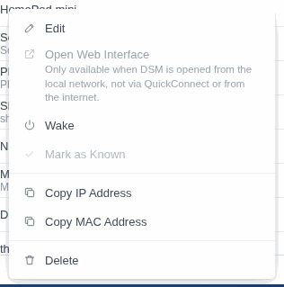

# Local Access, QuickConnect, VPN, and DDNS

SynetScan works the same however you reach DSM, with one exception: **Open Web Interface** and the **Open** links on a device's Services tab only work when your browser is in the NAS's local network. This page explains why, and how SynetScan tells the difference.

## Why web links need local access

The links point to the device's **local** address, such as `https://192.168.1.60/`. Your browser opens that address itself. If you are away from home and connected through QuickConnect, `192.168.1.60` means the network you are in right now: a hotel, an office, a mobile network. The link would fail, or worse, open a stranger's device that happens to have the same address.

SynetScan therefore greys out web links when you aren't in the local network, and explains why:

> Only available when DSM is opened from the local network, not via QuickConnect or from the internet.

Everything else (scanning, the device list, names, settings, Wake-on-LAN, export) works from anywhere you can reach DSM.

## How SynetScan decides

Two checks are combined:

1. **The service checks your browser's address.** The app asks the NAS where the request came from (the `REMOTE_ADDR` the web server reports) and compares it with the networks of the NAS's connected physical interfaces.
   - Inside one of them: **local**.
   - From loopback, or from the network of a virtual interface such as the QuickConnect relay tunnel (on DSM 7.4 for example `169.254.184.1` on `tun1000`): **remote** (relay).
   - From a link-local address (`169.254.x.x`, `fe80::`): **remote**. An unplugged port keeps a `169.254.0.0/16` address, which would otherwise also cover the relay tunnel's addresses.
   - From any other address, including public addresses (DDNS, port forwarding): **remote**.
2. **The browser checks the host name** in its address bar, as a veto:
   - an IP address in a private range (`10.x`, `172.16–31.x`, `192.168.x`) is plausible for local, and any other IP address (public, `127.0.0.1`, `100.x`…) means remote;
   - a QuickConnect host name means local only if it is the direct LAN form, such as `192-168-1-10.<your-id>.direct.quickconnect.to`, and remote otherwise;
   - a name without a dot (`diskstation`) or with a local suffix (`.local`, `.lan`, `.home`, `.fritz.box`, `.localdomain`, `.internal`, `.home.arpa`) is plausible for local;
   - any other name (for example your DDNS name) is no veto either way.

Links are enabled only if the service says **local** and the host name doesn't contradict it. If the service can't tell, the host name decides. A wrong "local" would silently open an address in whatever network you are in, so SynetScan prefers to grey out a link in doubtful cases.

## Common setups

| How you open DSM | Result | Why |
| --- | --- | --- |
| `https://192.168.1.10:5001` at home | **Local** | The browser's address is in the NAS's network. |
| `http://diskstation:5000` or `https://diskstation.local:5001` at home | **Local** | Same. |
| QuickConnect at home, DSM redirects you to `…direct.quickconnect.to` | **Local** | QuickConnect connects you directly in the LAN. |
| QuickConnect at home, but through the relay | **Remote** | Relayed requests arrive from the relay tunnel, not from your device. |
| QuickConnect away from home | **Remote** | Relay |
| DDNS name with port forwarding, away from home | **Remote** | The request comes from a public address. |
| DDNS name at home, resolving to the NAS's LAN address | **Local** | The browser's address is in the NAS's network. |
| DDNS name at home through the router's public address (NAT loopback) | Depends on the router: local if the request arrives from a LAN address, remote if from the public address | – |
| VPN on the router that puts you into the LAN subnet (proxy ARP, bridged VPN) | **Local** | Your VPN address is inside the NAS's network. |
| VPN into a separate VPN subnet (e.g. `10.8.0.0/24`) | **Remote** | Your address isn't in one of the NAS's networks, even if the links might work. |
| Tailscale or another VPN on the NAS itself | **Remote** | Requests arrive on a virtual interface. |
| SSH tunnel to `127.0.0.1` | **Remote** | Loopback host name |

> Verified with SynetScan 1.0.3 / DSM 7.4.1: over QuickConnect, the service reports *remote (relay)* and web links are greyed out. The other rows follow from the rules above.

## What to do if links are greyed out

- Open DSM through its **local address** (for example `https://192.168.1.10:5001`) while you're in the network.
- With QuickConnect at home: allow DSM to connect you directly. Whether QuickConnect uses a direct or relayed connection is decided by DSM and your network **(to verify which QuickConnect settings influence this)**.
- On a VPN into a separate subnet: you can still copy the address (right-click → **Copy IP Address**) and open it yourself, if your VPN routes to the LAN.

See also [Troubleshooting: "Open web interface" is disabled](Open-Web-Interface-Disabled).

## Session and security

However you connect, SynetScan uses your DSM session: no separate login, and only administrators. See [DSM Permissions, Security, and Privacy](Security-and-Privacy).

## Related articles

- [Device Actions and CSV Export](Device-Actions-and-CSV-Export)
- [Troubleshooting: "Open web interface" is disabled](Open-Web-Interface-Disabled)
- [Multiple Interfaces, VLANs, and Routed Networks](Interfaces-VLANs-and-Routed-Networks)
