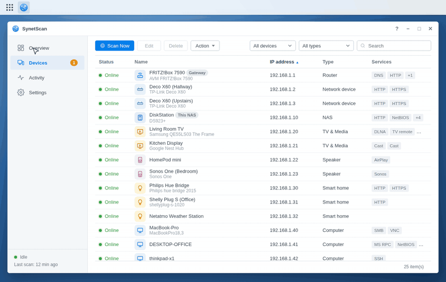
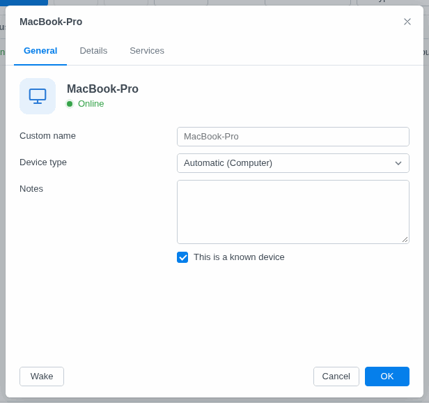

# Managing Names, Types, and Notes

## 1. What you will achieve

Your devices carry names you recognise ("Garden sensor" instead of `esp32-c3f1a0`), the right type icon, and notes such as where a device is or who owns it. Scans never overwrite any of this.

## 2. Prerequisites

- The device is in the device list.

## 3. Steps

1. Open **Devices** and double-click the device, or select it and click **Edit**. The **General** tab opens.

   

2. **Custom name**: type a name, up to 64 characters. The grey placeholder shows the name SynetScan detected. Leave the field empty to use the detected name again.
3. **Device type**: choose a type from the list. The first entry, **Automatic (…)**, shows SynetScan's own guess in brackets. Choose it to go back to automatic.
4. **Notes**: free text, up to 1,000 characters and several lines. Notes are included in the search and in the CSV export.
5. **This is a known device**: tick it to confirm the device. See [Reviewing Newly Discovered Devices](Reviewing-New-Devices).
6. Click **OK**. The message *The device has been saved.* confirms it. **Cancel** or Esc discards your changes.

## 4. Expected result

- The list shows your custom name. The second line shows the model or host name.
- The icon and the **Type** column show your chosen type. The type filter and **Online devices by type** use it too.
- Your name, type, notes and the known flag stay as they are, whatever later scans find. They only go when you delete the device or use **Delete All Data**.
- Activity events created from now on use the new name. Older events keep the name the device had at the time.

## 5. Common problems

| Problem | What to do |
| --- | --- |
| **The detected name is wrong or outdated.** | A custom name always wins. To make SynetScan detect it afresh, delete the device and let the next scan find it again. It will appear as new. See [A device has the wrong name or type](Wrong-Name-or-Type). |
| **The name looks different from what I typed.** | Invisible and control characters are removed, line breaks in the name become spaces, and the name is cut at 64 characters. |
| **Two entries for the same phone.** | The phone changed its private MAC address, and SynetScan sees two devices. Note the change in the old entry and delete it. See [A phone repeatedly appears offline](Phone-Appears-Offline). |
| **The type I need doesn't exist.** | Choose the closest type and use the notes. New types can be [requested](Reporting-Bugs). |

## 6. Related articles

- [Understanding Devices and Their Status](Devices-and-Status)
- [Device Actions and CSV Export](Device-Actions-and-CSV-Export)
- [How Discovery and Identification Work](How-Discovery-Works)
