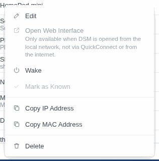

# "Open web interface" is disabled

← [Troubleshooting](Troubleshooting)

## Symptom

- In the context menu or the **Action** menu, **Open Web Interface** is greyed out, possibly with the note *Only available when DSM is opened from the local network, not via QuickConnect or from the internet.*
- On the device's **Services** tab, the **Open** links are grey, and a note at the top says the same.

## Likely explanation

There are four reasons. The note tells you which one applies.

1. **You aren't in the NAS's local network** (the note is shown). Over QuickConnect relay, a VPN into a separate subnet, DDNS from outside, or an SSH tunnel, the device's local address would lead nowhere, or to a device in the network you're in. SynetScan checks the address your browser connects from and the host name in the address bar. See [Local Access, QuickConnect, VPN, and DDNS](Local-Access-QuickConnect-VPN-and-DDNS).
2. **No web port was found** (no note). The menu item only uses ports 443, 5001, 80, 8080, 5000, 8443, 8123 and 32400. If none of them is open on the device, or not in your port list, there's nothing to open.
3. **The device has no usable address** (no note): it has only a link-local IPv6 address (`fe80::`), which browsers can't open.
4. **Several devices are selected** (no note). Select exactly one.

## Checks

1. Is there a note under the greyed-out item? Then it's reason 1.
2. How did you open DSM? Look at your browser's address bar. A QuickConnect name without `direct`, a public IP address, a DDNS name from outside, or `127.0.0.1` all mean remote.
3. Open the device's **Services** tab: which ports are open? Is one of the web ports listed?
4. **Settings → Ports**: are the web ports in the list? They are by default.

## Resolution

| Cause | Fix |
| --- | --- |
| Remote access | Open DSM through its local address (e.g. `https://192.168.1.10:5001`) while you're in the network, or use a VPN that puts you into the LAN subnet. Over a VPN into a separate subnet, you can still **Copy IP Address** and open the address yourself, if your VPN routes there. |
| No web port | Check that the device has a web interface at all. If it uses another port, add it under **Settings → Ports**. The menu item still only uses its fixed list, but the **Open** link on the Services tab also covers 81, 3000, 8000, 8008, 8081, 8888, 9000 and 9443. For any other port, copy the address and add the port yourself. |
| Only link-local IPv6 | The device needs an IPv4 address, or a global or unique-local IPv6 address. |
| Several selected | Select one device. |

## What to include in a bug report

If links are greyed out although you are in the local network:

- How you open DSM (the form of the address in the address bar, e.g. `https://192.168.x.x:5001` or `xyz.direct.quickconnect.to`)
- Your computer's IP address and the NAS's network (**Overview → Network**)
- Whether you use a VPN, proxy or reverse proxy in front of DSM

## Related articles

- [Local Access, QuickConnect, VPN, and DDNS](Local-Access-QuickConnect-VPN-and-DDNS)
- [Device Actions and CSV Export](Device-Actions-and-CSV-Export#open-web-interface)
- [Ports and Discovery Options](Ports-and-Discovery)
