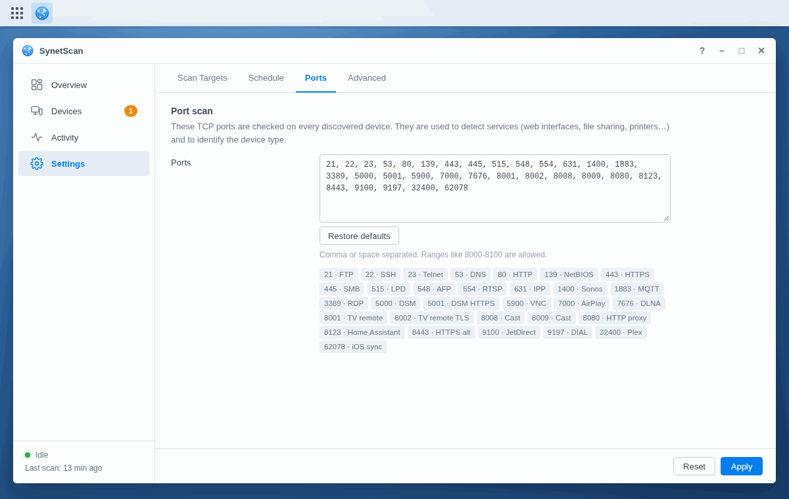
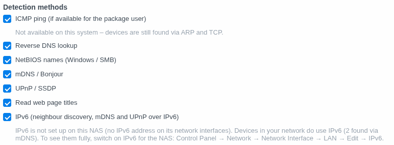

# Ports and Discovery Options

This page explains the **Ports** tab (which TCP ports are checked on each device, and why) and the **Detection methods** on the **Advanced** tab.

## How SynetScan uses ports

Ports are used at two points in a scan, and only one of them can be configured:

1. **Discovery (fixed).** To find out whether an address is in use, SynetScan tries to connect to nine common ports at once: **80, 443, 22, 445, 62078, 8080, 1400, 8001 and 8009**. Any answer, even a refusal, proves that a device is there. In the local network, the ARP table also reveals devices that don't answer at all. This list can't be changed, so a short port list never makes SynetScan miss devices.
2. **Port scan (configurable).** Every device found is then checked on the ports of **Settings → Ports**. Open ports are listed in the **Services** column and tab, they enable **Open Web Interface**, and they are one of the main clues for the [device type](Devices-and-Status#device-types).

The port scan is **TCP only**. UDP services such as SNMP (161/udp), DHCP or mDNS (5353/udp) can't be detected this way. SynetScan learns about mDNS and UPnP through their own protocols instead.

A port counts as **open** if the device accepts the connection. SynetScan closes the connection right away and sends nothing. Only on web ports does it then send a single request for the start page, if **Read web page titles** is on.

## The Ports tab

- **Ports** (*Ports*): comma- or space-separated port numbers from 1 to 65535. Ranges like `8000-8100` are allowed.
- Below the field, a preview shows each entry with its service name, and marks invalid entries in red.
- **Restore defaults** (*Standard wiederherstellen*) puts the default list back into the field. Click **Apply** to save it.

Limits: each range may span up to 1,025 ports (for example `8000-9024`), and the whole list may hold up to 2,048 different ports. Duplicates are removed, and the list is saved sorted.

## The default ports explained

The defaults (31 ports) cover what you typically find in homes and small offices. Each one either reveals a service you may want to open, or helps recognise the device type.

| Port | Name in SynetScan | Typically found on | Why it's in the list |
| --- | --- | --- | --- |
| 21 | FTP | NAS, routers with USB storage, old printers | Shows file transfer services. FTP sends passwords in clear text, so it's worth knowing about. |
| 22 | SSH | Linux servers, Raspberry Pi, NAS, routers, switches | Remote shell. Together with web or database ports, it points to a **Server**. |
| 23 | Telnet | Old routers, switches, IoT devices | Unencrypted remote access, usually a sign of an old or poorly secured device |
| 53 | DNS | Routers, Pi-hole, AdGuard Home, DNS servers | Name servers also answer over TCP. Helps recognise routers. |
| 80 | HTTP | Almost everything with a web interface | Web interface; its page title helps identify the device |
| 139 | NetBIOS | Windows PCs, Samba servers, NAS | Windows file sharing (old style). With a NetBIOS name, it points to a **Computer**. |
| 443 | HTTPS | Routers, NAS, cameras, printers, smart home hubs | Encrypted web interface. First choice for **Open Web Interface**. |
| 445 | SMB | Windows PCs, Macs with file sharing, NAS | File sharing. Also one of the discovery ports. |
| 515 | LPD | Network printers | Line printer daemon. Means **Printer**. |
| 548 | AFP | Older Macs, Time Capsule, NAS | Apple file sharing. Helps recognise storage devices. |
| 554 | RTSP | IP cameras, NVRs, video doorbells, some media players | Video streaming. Means **Camera**. |
| 631 | IPP | Printers, Macs and PCs that share a printer | Internet Printing Protocol (AirPrint, Mopria) |
| 1400 | Sonos | Sonos speakers | Sonos control port. Means **Speaker**. |
| 1883 | MQTT | Smart home hubs, Home Assistant, Zigbee2MQTT, ESP devices | IoT messaging. Means **Smart home**. |
| 3389 | RDP | Windows PCs and servers with Remote Desktop enabled | Means **Computer**. |
| 5000 | DSM | Synology NAS (DSM over HTTP), some other web apps | Both 5000 and 5001 open means **NAS**. |
| 5001 | DSM HTTPS | Synology NAS (DSM over HTTPS) | See 5000. |
| 5900 | VNC | Macs with Screen Sharing, Raspberry Pi, PCs with VNC | Remote screen access |
| 7000 | AirPlay | Apple TV, HomePod, Macs, AirPlay speakers | AirPlay receivers |
| 7676 | DLNA | Samsung TVs | Samsung TV service port. Means **TV & Media**. |
| 8001 | TV remote | Samsung TVs | Samsung remote control API. Means **TV & Media**. |
| 8002 | TV remote TLS | Samsung TVs | Encrypted version of 8001 |
| 8008 | Cast | Chromecast, Google/Nest speakers and displays, Android TV | Google Cast (HTTP) |
| 8009 | Cast | Same as 8008 | Google Cast. Means **TV & Media** unless other clues say otherwise. |
| 8080 | HTTP proxy | Routers, cameras, web apps, proxies | Second web port. Read for the page title. |
| 8123 | Home Assistant | Home Assistant | Means **Smart home**. Opens with **Open Web Interface**. |
| 8443 | HTTPS alt | UniFi controllers, routers, web apps | Second HTTPS port |
| 9100 | JetDirect | Network printers | Raw printing. Means **Printer**. |
| 9197 | DIAL | Smart TVs (Samsung and others) | Second-screen protocol. Means **TV & Media**. |
| 32400 | Plex | Plex Media Server | Opens with **Open Web Interface** |
| 62078 | iOS sync | iPhones and iPads | Apple's device sync service. Means **Phone** (or **Tablet**, if the name says iPad). Also a discovery port. |

SynetScan also knows the names of these ports, which aren't in the defaults: 20 FTP data, 25 SMTP, 81 HTTP alt, 88 Kerberos, 110 POP3, 111 RPC, 135 MS RPC, 143 IMAP, 161 SNMP, 389 LDAP, 465 SMTPS, 587 SMTP sub, 873 rsync, 993 IMAPS, 995 POP3S, 1080 SOCKS, 1433 MSSQL, 1900 UPnP, 2049 NFS, 3000 HTTP dev, 3306 MySQL, 3689 DAAP, 5060 SIP, 5353 mDNS, 5432 PostgreSQL, 6379 Redis, 8000 HTTP alt, 8081 HTTP alt, 8883 MQTT TLS, 8888 HTTP alt, 9000 HTTP alt, 9443 HTTPS alt, 10000 Webmin, 49152 UPnP. Other ports are shown by number.

### Ports that change the device type

The classifier uses ports together with the vendor, names and announced services. The ports that matter most:

| Open ports | Leads to |
| --- | --- |
| 5000 **and** 5001 | NAS |
| 9100 or 515 | Printer |
| 554 | Camera |
| 1400 | Speaker |
| 8009, or any of 7676, 8001, 8002, 9197 | TV & Media |
| 62078 | Phone |
| 1883 or 8123 | Smart home |
| 3389, or 139/445 together with a NetBIOS name | Computer |
| 22 together with 80, 443, 3306, 5432, 6379, 8080 or 25 | Server |
| 22 alone, as a last resort | Server |

Ports 3306, 5432, 6379 and 25 aren't in the defaults. Add them if you want database and mail servers to be recognised as servers. See [Custom Port Lists](Custom-Port-Lists).

## Choosing your own port list

- **Adding ports** shows more services and improves recognition, at the cost of scan time on devices that ignore connection attempts. See [Scan Schedule and Performance](Schedule-and-Performance#what-else-affects-the-duration).
- **Removing ports** makes the identification phase faster, but the type guess and **Open Web Interface** may suffer. Keep 80, 443, 5000, 5001, 8080, 9100, 62078 and the TV ports unless you have a reason not to.
- **Open Web Interface** only uses 443, 5001, 80, 8080, 5000, 8443, 8123 and 32400. The **Open** links on the Services tab also cover 81, 3000, 8000, 8008, 8081, 8888, 9000 and 9443. A web interface on any other port is listed as open, but SynetScan won't link to it.
- **Web page titles** are read from ports 80, 8080, 443 and 5000 only, in that order.

Ready-made lists for typical situations are on **[Custom Port Lists for Common Situations](Custom-Port-Lists)**.

## Detection methods

**Settings → Advanced → Detection methods** switches individual identification methods on or off. All are on by default.

| Option | German | What it does | Switch it off if… |
| --- | --- | --- | --- |
| **ICMP ping (if available for the package user)** | ICMP-Ping (falls für den Paketbenutzer verfügbar) | Pings addresses that didn't answer on any discovery port, and measures the response time. Only works if the system's `ping` works for the package user. If it doesn't, Settings shows *Not available on this system – devices are still found via ARP and TCP.* | …you scan large empty routed ranges and want faster scans. |
| **Reverse DNS lookup** | Reverse-DNS-Abfrage | Asks the NAS's DNS server for each address's name (`PTR` record). Your router usually knows the names devices gave when they got their address. | …your DNS server is outside your network and you don't want it to see these queries, or lookups are slow. |
| **NetBIOS names (Windows / SMB)** | NetBIOS-Namen (Windows / SMB) | Sends a NetBIOS name query (UDP 137). Gives the computer name, workgroup and the MAC address of Windows PCs and Samba servers, also in routed networks. | …you have no Windows or Samba devices. |
| **mDNS / Bonjour** | mDNS / Bonjour | Asks for Bonjour services (`224.0.0.251`, UDP 5353) and asks each device for its `.local` name. Gives names, models and services of Apple devices, printers, speakers, Chromecasts and smart home devices. | …rarely useful. |
| **UPnP / SSDP** | UPnP / SSDP | Sends an SSDP search (`239.255.255.250`, UDP 1900) and reads the UPnP description of each device that answers: friendly name, manufacturer, model. Routers, TVs, media servers and game consoles answer. | …rarely useful. |
| **Read web page titles** | Titel von Webseiten auslesen | Requests the start page on ports 80, 8080, 443 and 5000 and reads its title and `Server` header | …devices log or alert on page requests from the NAS. |
| **IPv6 (neighbour discovery, mDNS and UPnP over IPv6)** | IPv6 (Nachbarerkennung, mDNS und UPnP über IPv6) | Finds IPv6 addresses and IPv6-only devices. Below the option, Settings summarises the last scan's IPv6 result. See [IPv6](IPv6). | …the NAS has no IPv6, or you don't care about IPv6. |

Notes:

- Switching **mDNS / Bonjour** off also stops mDNS over IPv6. Switching **UPnP / SSDP** off also stops SSDP over IPv6. WS-Discovery over IPv6 runs whenever IPv6 is on.
- None of these options affects *whether* a local device is found: discovery through TCP and the ARP table always runs. They affect how well a device is identified, and how long the scan takes.
- SynetScan never reads the UPnP description from any machine other than the one that announced it, and follows web redirects only on the same device. See [Security](Security-and-Privacy).

## Related articles

- [Custom Port Lists for Common Situations](Custom-Port-Lists)
- [Enabling ICMP Ping on DSM](Enabling-ICMP-Ping)
- [How Discovery and Identification Work](How-Discovery-Works)
- [Complete Settings Reference](Settings-Reference)
