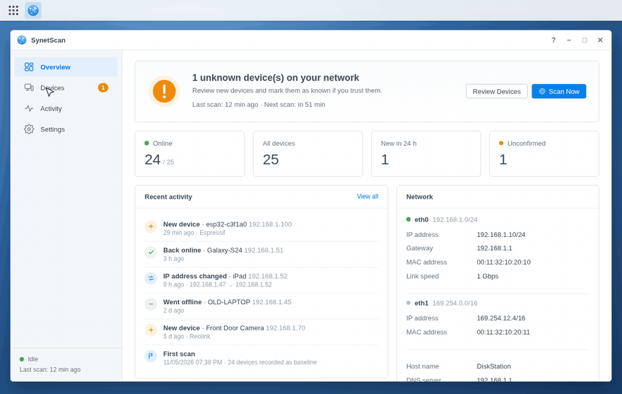
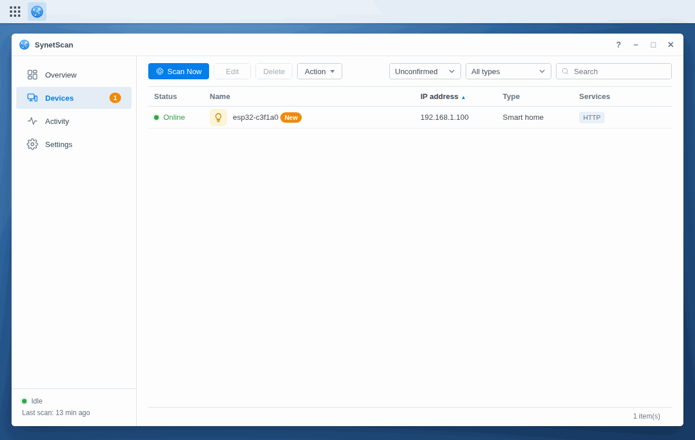

# Reviewing Newly Discovered Devices

## 1. What you will achieve

You find out what a newly discovered device is, decide whether it belongs on your network, and mark it as known. Afterwards the **New** badge is gone and the Overview reports *Your network looks fine*.

## 2. Prerequisites

- At least one scan after the first one. The devices of the first scan are known automatically ([baseline](First-Scan#what-the-baseline-means)).
- The Overview says **N unknown device(s) on your network**, or the **Devices** navigation item has an orange badge.

## 3. Steps

### Step 1: List the unconfirmed devices

On the Overview, click **Review Devices**, or click the **Unconfirmed** tile. The device list opens filtered to *Unconfirmed*.

### Step 2: Find out what the device is

Double-click the device and look at the **Details** and **Services** tabs. These clues usually identify it:

| Clue | Where | Example |
| --- | --- | --- |
| **Vendor** | Details | *Espressif*: an ESP8266/ESP32 chip, used in many smart plugs and DIY sensors |
| **Host names** | Details: DNS name, mDNS name, NetBIOS name | `esp32-c3f1a0.lan`, `DESKTOP-OFFICE` |
| **Model / UPnP device** | Details | *Samsung QE55LS03 The Frame* |
| **Web page** | Details | The title of its web interface |
| **Services** | Services tab | 9100 JetDirect means a printer, 62078 *iOS sync* an iPhone or iPad, 8009 *Cast* a Chromecast-type device |
| **First seen** | Details | Does the time match when you set something up? |
| **Interface** | Details | Which network port or range it was found in |

If the device has a web interface and you are in the local network, **Open Web Interface** in the context menu takes you there.

A **private MAC address** (Vendor: *Private address*) is typical for phones, tablets and laptops. Their vendor stays unknown, so the host name and the time it appeared are the best clues. A visiting guest's phone is a common case.

### Step 3: Mark the device as known

Use whichever way suits you:

- **Right-click** the device and choose **Mark as Known**. This also works for several selected devices at once.
- **Action → Mark as Known** in the toolbar.
- In the device dialog, tick **This is a known device** and click **OK**. Use this when you also want to give it a name.

The **New** badge disappears and the unconfirmed count goes down.

### Step 4 (optional): Name it

While you know what the device is, give it a **Custom name**, correct its **Device type** and add **Notes**. See [Managing Names, Types, and Notes](Names-Types-and-Notes).

## 4. Expected result

- The device no longer has a **New** badge and no longer counts as *Unconfirmed*.
- Once all devices are known, the Overview banner shows **Your network looks fine**.
- The device's history (first seen, events) is unchanged.

To undo it, open the device and untick **This is a known device**.

## 5. Common problems

| Problem | What to do |
| --- | --- |
| **I don't recognise the device at all.** | Note its MAC address and IP address (right-click → **Copy MAC Address**) and look them up in your router's list of clients, which often shows the device name the device gave when it asked for an IP address. You can also open the web interface, or check which Wi-Fi access point it is connected to. If you suspect a stranger, change your Wi-Fi password. |
| **The same phone keeps coming back as new.** | It probably rotates its private MAC address. See [A phone repeatedly appears offline](Phone-Appears-Offline). |
| **A device I deleted comes back as New.** | That's by design: a deleted device is new when it's found again. Mark it as known instead of deleting it. See [Troubleshooting](Troubleshooting#a-deleted-device-reappears). |
| **"Mark as Known" is greyed out.** | All selected devices are already known. |
| **The name or type is wrong.** | See [A device has the wrong name or type](Wrong-Name-or-Type). |

## 6. Related articles

- [Understanding Devices and Their Status](Devices-and-Status)
- [Activity Events and Scan History](Activity-and-Scan-History)
- [Managing Names, Types, and Notes](Names-Types-and-Notes)
- [DSM Permissions, Security, and Privacy](Security-and-Privacy)
