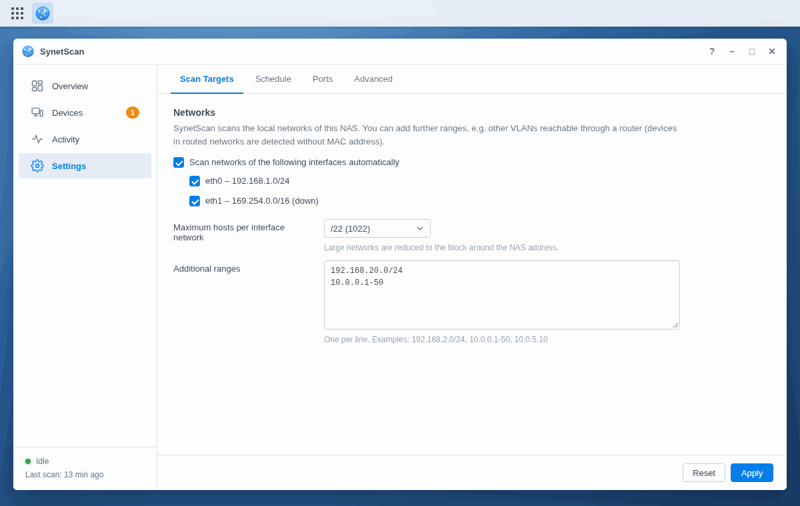
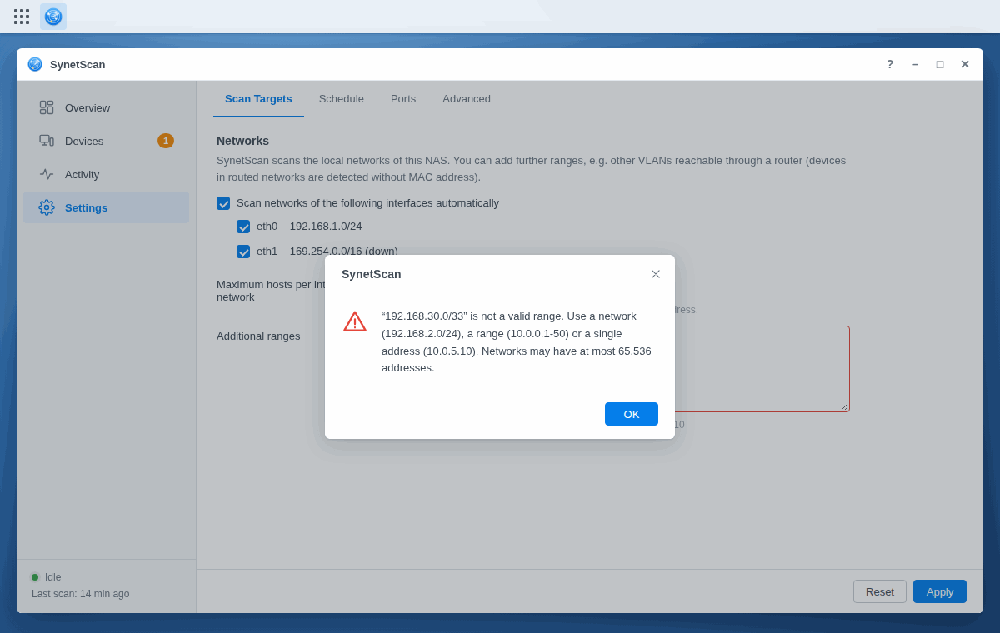

# Scan Targets and Custom Ranges

**Settings → Scan Targets** decides which IPv4 addresses SynetScan scans. By default, it scans every network the NAS is directly connected to. You can leave out interfaces and add more ranges, for example other VLANs behind a router.

IPv6 isn't configured here. It is discovered on the same interfaces automatically. See [IPv6](IPv6).

## Networks of the NAS's interfaces

**Scan networks of the following interfaces automatically** (*Netzwerke folgender Schnittstellen automatisch scannen*) is on by default. Below it, every physical interface of the NAS is listed with its network, for example `eth0 – 192.168.1.0/24`. Interfaces without a link are marked *(down)*.

- **Ticked** interfaces are scanned: their whole network, apart from the network and broadcast address.
- Untick an interface to leave it out, for example a storage network between the NAS and a backup server.
- Interfaces that are down, or that only have a self-assigned address (`169.254.x.x`), are skipped automatically.
- **Virtual interfaces are never scanned automatically**: Docker and Container Manager bridges (`docker*`, `veth*`, `br-*`), VPN and tunnel interfaces (`tun*`, `tap*`, `wg*`, `tailscale*`, `zt*`), virtual machine bridges (`virbr*`, `vnet*`) and similar. Their names start with `lo`, `docker`, `veth`, `br-`, `virbr`, `tun`, `tap`, `sit`, `dummy`, `ip6tnl`, `gre`, `wg`, `zt`, `tailscale`, `lxc`, `cni`, `flannel`, `kube` or `vnet`. Add a custom range if you want to scan one of them anyway.
- Bonded interfaces (`bond0`), VLAN interfaces and the Open vSwitch interfaces DSM creates for Virtual Machine Manager (`ovs_eth0`) count as physical and are scanned.

If you untick the main checkbox, SynetScan scans only your additional ranges.

### Maximum hosts per interface network

**Maximum hosts per interface network** (*Max. Hosts pro Schnittstellennetz*) limits how much of a large network is scanned. The default is **/22 (1022)**.

If an interface's network is larger, for example a `/16` with 65,534 addresses, SynetScan scans only the block around the NAS's own address that fits the limit.

> Example: the NAS has `10.0.5.20/16`. With the default limit, SynetScan scans `10.0.4.0/22`, that is `10.0.4.1` to `10.0.7.254`.

Choices: /24 (254), /23 (510), /22 (1022), /21 (2046), /20 (4094) and /19 (8190) hosts. Networks of /24 or smaller are always scanned completely.

A larger limit finds more of a large network, but each scan takes longer. As a rough guide, the discovery phase takes about *addresses ÷ parallel probes × probe timeout*. To scan a whole large network, raise the limit, or add the network as an additional range.

## Additional ranges

**Additional ranges** (*Zusätzliche Bereiche*): one entry per line. Commas are accepted as separators too.

| Format | Example | Scans |
| --- | --- | --- |
| Network (CIDR) | `192.168.2.0/24` | `192.168.2.1`–`192.168.2.254` (without network and broadcast address) |
| Very small network | `10.0.9.4/31`, `10.0.9.7/32` | every address of it |
| Single address | `10.0.5.10` | that address |
| Range in the last part | `10.0.0.1-50` | `10.0.0.1`–`10.0.0.50` |
| Full range | `10.0.0.200-10.0.1.20` | `10.0.0.200`–`10.0.1.20` |

Rules:

- Each entry may cover at most **65,536 addresses**, so a `/16` is the largest network.
- In the short form `a.b.c.d-N`, N is the last part of the end address (0–255). The range stays within the same block of 256 addresses.
- At most **64 entries**. *Available since 1.1.3.* Combine single addresses into ranges or networks.
- A whole scan, interfaces and additional ranges together, covers at most 65,536 addresses. Addresses beyond that are left out.
- Addresses in both an interface network and an additional range are scanned once.

When you click **Apply**, SynetScan checks every entry. An invalid entry is highlighted and explained, and nothing is saved:

## Guide: scan another VLAN or subnet

### 1. What you will achieve

SynetScan also lists the devices of a network the NAS isn't directly connected to, for example an IoT VLAN `192.168.20.0/24` behind your router.

### 2. Prerequisites

- The NAS can reach the other network through a router, and the router or firewall allows the NAS to connect to it.
- You know the network's address range.

### 3. Steps

1. Open **Settings → Scan Targets**.
2. In **Additional ranges**, enter the network on a line of its own, e.g. `192.168.20.0/24`.
3. Click **Apply**. The message *Settings have been saved.* confirms it.
4. Click **Scan Now** on the Overview or the Devices page.

### 4. Expected result

- **Activity → Scan History** lists the new range in the **Ranges** column, and the Overview's **Network** card lists it under **Scanned ranges**.
- Devices of that network appear in the list. Their **Interface** in the Details tab is *custom*.
- They have **no MAC address and no vendor**. That's normal for routed networks: a MAC address can only be learned on the local network segment. Windows and Samba devices are an exception, because their NetBIOS answer contains the MAC address.

### 5. Common problems

- **Nothing is found.** The router or firewall between the networks probably blocks the NAS. SynetScan finds routed devices through TCP connections to a few common ports (80, 443, 22, 445, 62078, 8080, 1400, 8001, 8009) and, if available, ping. If the other network's firewall drops these, nothing answers. Allow traffic from the NAS's address to that network, or [enable ICMP ping](Enabling-ICMP-Ping) and allow ICMP echo.
- **Devices have no names.** Bonjour/mDNS and UPnP announcements don't cross routers. Names then come only from reverse DNS and NetBIOS.
- **A device appears twice after it got a new IP address.** Without a MAC address, SynetScan recognises routed devices by IP address. Give such devices fixed addresses (DHCP reservations) on your router.
- **Wake-on-LAN doesn't work.** It needs a MAC address and a broadcast in the device's own network.

See [Multiple Interfaces, VLANs, and Routed Networks](Interfaces-VLANs-and-Routed-Networks) for the background.

### 6. Related articles

- [Multiple Interfaces, VLANs, and Routed Networks](Interfaces-VLANs-and-Routed-Networks)
- [Scan Schedule and Performance](Schedule-and-Performance)
- [Complete Settings Reference](Settings-Reference)

## Other uses of additional ranges

- **Scan only part of your network.** Untick the automatic interface scan and enter the ranges you want, for example `192.168.1.1-99` and `192.168.1.101-254` to leave out `192.168.1.100`. SynetScan has no separate exclusion list.
- **Scan a whole large network.** Add it as a range, e.g. `10.0.0.0/16`. Expect much longer scans: see [Performance](Schedule-and-Performance).
- **Scan a Docker bridge or a VPN network** that is skipped automatically, for example a WireGuard network. Devices reached through a tunnel are routed devices: no MAC address, no Bonjour names.

> **Only scan networks you are responsible for.** SynetScan accepts any IPv4 range, including public addresses. Scanning networks that aren't yours may break their terms of use or the law.

## Related articles

- [Scan Schedule and Performance](Schedule-and-Performance)
- [Multiple Interfaces, VLANs, and Routed Networks](Interfaces-VLANs-and-Routed-Networks)
- [Complete Settings Reference](Settings-Reference#scan-targets)
