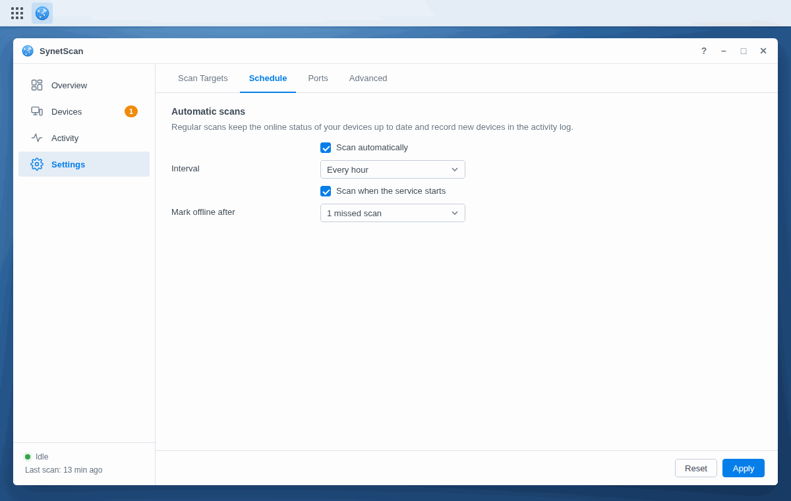
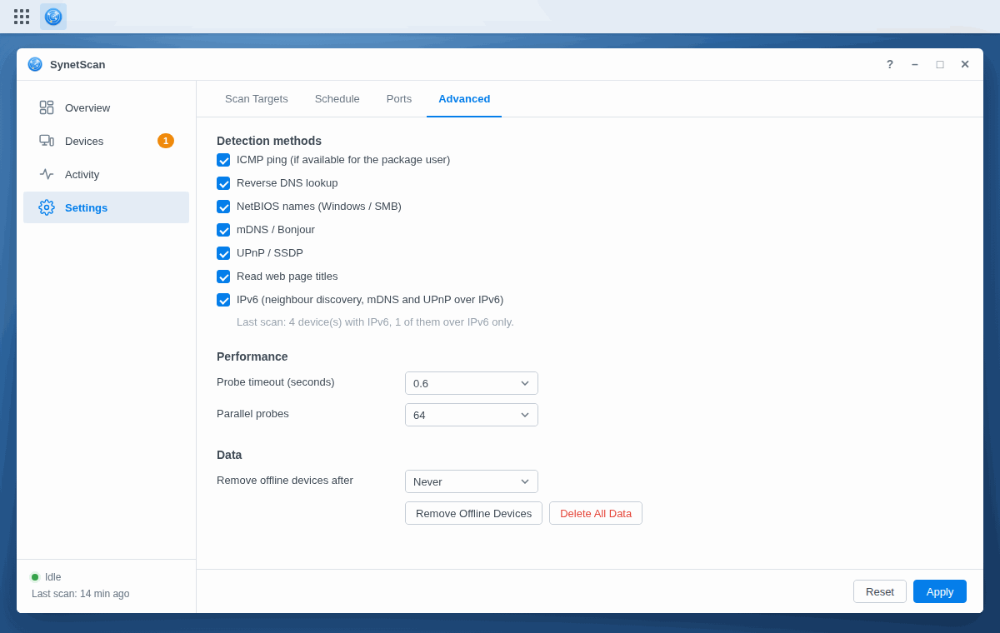

# Scan Schedule and Performance

**Settings → Schedule** controls when SynetScan scans and when a device counts as offline. **Settings → Advanced → Performance** controls how fast and how hard it probes.

## Automatic scans

| Setting | German | Default | Choices |
| --- | --- | --- | --- |
| **Scan automatically** | Automatisch scannen | on | on / off |
| **Interval** | Intervall | Every hour | Every 5, 10, 15 or 30 minutes; every hour; every 2, 4, 6 or 12 hours; once a day |
| **Scan when the service starts** | Beim Start des Dienstes scannen | on | on / off |
| **Mark offline after** | Als offline markieren nach | 1 missed scan | 1, 2, 3 or 5 missed scans |

**How the interval is counted.** The next automatic scan is due one interval after the **end of the last scan**, whether that scan was automatic, manual or the one at service start. A manual scan therefore postpones the next automatic one. After a failed or cancelled scan, SynetScan waits a full interval too, so errors never cause a rapid series of retries. The Overview banner shows *Next scan: in … min*, or **Manual only** when automatic scans are off.

**Scan when the service starts.** The service starts when you start the package, when the NAS boots, and after every package update. With this option on, SynetScan scans right away, so the list is up to date after a restart. The scan history shows these scans as **Service start**.

With **Scan automatically** off, SynetScan only scans when you click **Scan Now**, and at service start if that option is on. Online and offline states are then only as recent as your last manual scan.

### Choosing an interval

| Interval | Good for |
| --- | --- |
| 5–15 minutes | Noticing new devices quickly; keeping the online status of laptops and phones current. More probes on your network, and more *Went offline / Back online* events for sleeping devices. |
| **1 hour** (default) | Home and small office networks. A good balance. |
| 2–6 hours | Large ranges (several /22 networks or more), slow routed networks, or a NAS with a slow CPU |
| 12 hours – once a day | An inventory that barely changes |

A /24 network takes about 8 to 15 seconds. Even a 5-minute interval keeps the NAS busy for only a small fraction of the time.

### Mark offline after

A device is marked offline after it has missed this many scans in a row. With the default of **1**, a device is offline as soon as one scan doesn't find it.

Raise it to **2, 3 or 5** if devices often flip between online and offline: phones, tablets, speakers and TVs in power-saving mode. This calms the activity log, but real departures show up later: with 3 missed scans and an hourly interval, after about three hours.

See [A phone repeatedly appears offline](Phone-Appears-Offline).

## Performance

| Setting | German | Default | Choices |
| --- | --- | --- | --- |
| **Probe timeout (seconds)** | Zeitlimit pro Prüfung (Sekunden) | 0.6 | 0.3, 0.6, 1, 1.5, 2, 3 |
| **Parallel probes** | Parallele Prüfungen | 64 | 16, 32, 64, 128, 256 |

**Probe timeout** is how long SynetScan waits for an answer to a TCP connection attempt:

- In the **discovery** phase, each address gets connection attempts to nine common ports at once, and SynetScan waits up to the timeout for any answer.
- In the **port scan** of each device found, ports are checked in groups of 32. Each group waits up to the timeout plus 0.3 seconds.

On a wired LAN, devices answer within a few milliseconds, so 0.6 seconds is generous. Raise the timeout for slow links: VPNs, routed networks behind a slow router, or Wi-Fi devices that wake up slowly. Lower it (0.3) to make scans of large empty ranges faster.

**Parallel probes** is how many addresses are checked at the same time in the discovery phase. While devices are being identified, half as many (at least 8) are examined in parallel.

- More parallel probes make large ranges faster.
- Fewer put less load on the NAS and the network. Consider 16 or 32 for a NAS with a slow CPU, or if a firewall or a cheap router complains about too many connections.

### How long will a scan take?

A rough estimate of the discovery phase:

> addresses ÷ parallel probes × (probe timeout + 1 second if ping is available)

The extra second applies to addresses that don't answer on any discovery port, when ICMP ping is available and switched on: they also get a one-second ping. Identification then adds a few seconds, depending on the number of devices and how quickly their web servers and UPnP descriptions answer. Each device has a fixed time budget, so a slow device can't stall the scan. Finally, SynetScan waits until about 8 seconds after the discovery phase to check devices that were only in the ARP cache.

| Network | Typical duration |
| --- | --- |
| One /24 (254 addresses), defaults | 8–15 s |
| A /22 (1022 addresses), defaults | roughly 20–40 s |
| Several networks or a /16 as an additional range | minutes; consider a longer interval |

These are estimates. The **Duration** column in **Activity → Scan History** shows the real values for your network.

### What else affects the duration

- **Long port lists.** Each group of 32 ports costs up to *timeout + 0.3 s* on a device that ignores connection attempts. 2,048 ports are 64 groups, nearly a minute per firewalled device. See [Ports and Discovery Options](Ports-and-Discovery).
- **IPv6 discovery** runs alongside the IPv4 phases and adds little.
- **Many devices with web interfaces**: titles and UPnP descriptions are fetched for each device, within a time budget of 8 seconds per device for each.

## Related articles

- [Complete Settings Reference](Settings-Reference)
- [Scan Targets and Custom Ranges](Scan-Targets)
- [How Discovery and Identification Work](How-Discovery-Works)
