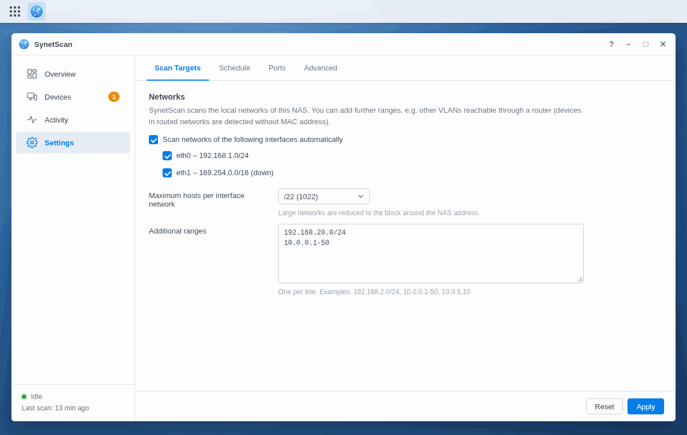
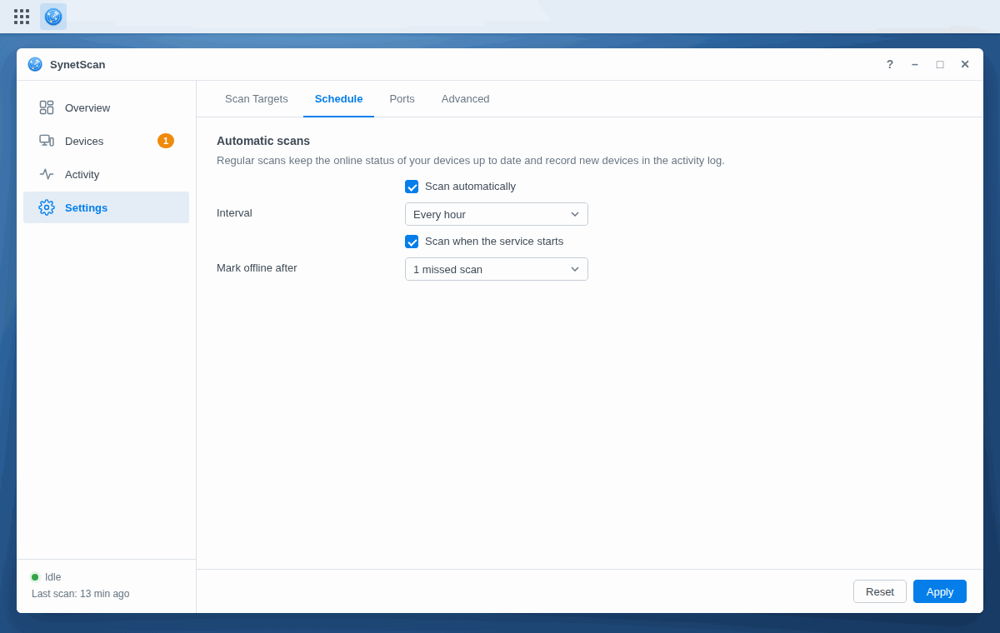
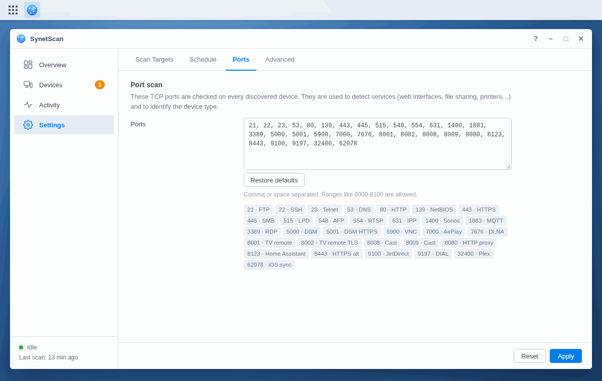
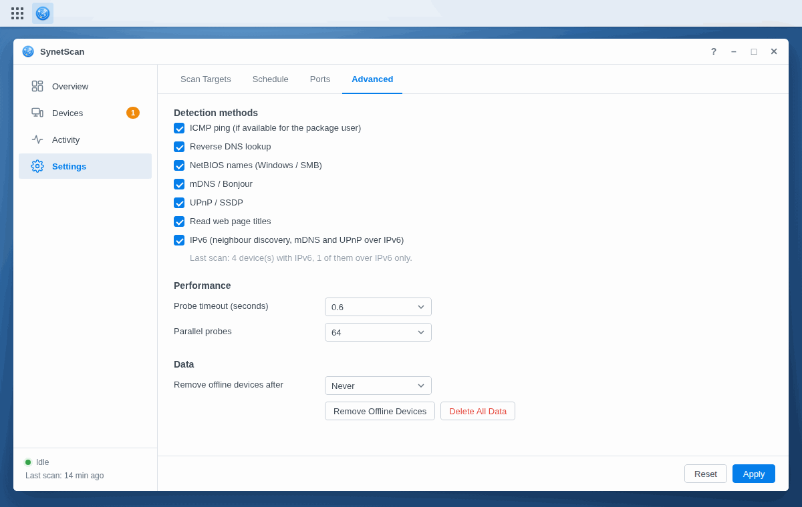

# Complete Settings Reference

Every setting in **Settings**, with its label in English and German, its default, the allowed values and its effect. The **Key** column is the name in `config.json` and the [internal API](Internal-API). You only need it for diagnosis or backups.

General rules:

- Changes take effect when you click **Apply**. **Reset** discards changes you haven't applied.
- New settings apply from the next scan on. A running scan finishes with the settings it started with.
- Every value is checked when you apply it. Invalid values are rejected with a message, and nothing is saved.
- "UI choices" are the values the Settings page offers. The service accepts the wider "Allowed range", which only matters if `config.json` is edited by hand. A value outside the UI choices shows the first choice in the list, and saving the page then replaces it.

## Scan Targets



| Setting | Key | Default | Allowed | Effect |
| --- | --- | --- | --- | --- |
| **Scan networks of the following interfaces automatically**<br>*Netzwerke folgender Schnittstellen automatisch scannen* | `auto_subnets` | on | on / off | Scans the network of every physical interface that is up, has an address outside `169.254.0.0/16` and isn't unticked below. Off: only the additional ranges are scanned. |
| **Interface checkboxes** (one per physical interface) | `excluded_interfaces` | all ticked (empty list) | list of interface names, up to 64 | Unticked interfaces aren't scanned automatically. IPv6 discovery leaves them out too. |
| **Maximum hosts per interface network**<br>*Max. Hosts pro Schnittstellennetz* | `max_hosts_per_subnet` | 1024 (shown as /22 (1022)) | UI: 256, 512, 1024, 2048, 4096, 8192 (/24 … /19). Allowed range: 16–16384 | Larger interface networks are reduced to the largest block around the NAS's address that has at most this many hosts. Disabled while the automatic scan is off. |
| **Additional ranges**<br>*Zusätzliche Bereiche* | `custom_targets` | empty | up to 64 entries; each a network (CIDR), a single address, `a.b.c.d-N` or `a.b.c.d-e.f.g.h`, at most 65,536 addresses each | Scanned in addition. One per line, commas also work. See [Scan Targets](Scan-Targets#additional-ranges). |

Limits: a scan covers at most 65,536 IPv4 addresses in total. Entries are cut to 80 characters before they are checked. The limit of 64 entries is *available since 1.1.3*.

## Schedule



| Setting | Key | Default | Allowed | Effect |
| --- | --- | --- | --- | --- |
| **Scan automatically**<br>*Automatisch scannen* | `schedule_enabled` | on | on / off | Runs scans on the interval below. Off: the Overview shows *Manual only*. |
| **Interval**<br>*Intervall* | `schedule_interval` | 60 (Every hour) | UI: 5, 10, 15, 30, 60, 120, 240, 360, 720, 1440 minutes. Allowed range: 5–1440 | Time from the end of the last scan (or scan attempt) to the next automatic scan. Disabled while automatic scans are off. |
| **Scan when the service starts**<br>*Beim Start des Dienstes scannen* | `scan_on_start` | on | on / off | Scans as soon as the package service starts: package start, NAS boot, package update. |
| **Mark offline after**<br>*Als offline markieren nach* | `offline_after_scans` | 1 | UI: 1, 2, 3, 5 missed scans. Allowed range: 1–10 | Number of scans in a row a device must miss before it counts as offline and a *Went offline* event is recorded. Only scans that covered the device's address count. |

Details: [Scan Schedule and Performance](Schedule-and-Performance).

## Ports



| Setting | Key | Default | Allowed | Effect |
| --- | --- | --- | --- | --- |
| **Ports**<br>*Ports* | `ports` | `21, 22, 23, 53, 80, 139, 443, 445, 515, 548, 554, 631, 1400, 1883, 3389, 5000, 5001, 5900, 7000, 7676, 8001, 8002, 8008, 8009, 8080, 8123, 8443, 9100, 9197, 32400, 62078` | Ports 1–65535 separated by commas or spaces. Ranges `a-b` up to 1,024 ports. At most 2,048 different ports in total. | TCP ports checked on every device found. Used for the Services list, Open Web Interface and the device type. Doesn't affect discovery. |
| **Restore defaults**<br>*Standard wiederherstellen* | – | – | – | Puts the default list into the field. Click **Apply** to save it. |

Configurations saved by SynetScan 1.0.0 with the 1.0.0 default list are moved to the current default list automatically (it added 7676, 8001, 8002 and 9197).

Details: [Ports and Discovery Options](Ports-and-Discovery), [Custom Port Lists](Custom-Port-Lists).

## Advanced



### Detection methods

| Setting | Key | Default | Effect when on |
| --- | --- | --- | --- |
| **ICMP ping (if available for the package user)**<br>*ICMP-Ping (falls für den Paketbenutzer verfügbar)* | `use_ping` | on | Pings addresses that answered on no discovery port (one ping, one-second timeout) and records the response time. Has no effect if the system ping doesn't work for the package user; then a hint is shown. See [Enabling ICMP Ping](Enabling-ICMP-Ping). |
| **Reverse DNS lookup**<br>*Reverse-DNS-Abfrage* | `use_dns` | on | Looks up each address's DNS name through the NAS's resolver. |
| **NetBIOS names (Windows / SMB)**<br>*NetBIOS-Namen (Windows / SMB)* | `use_netbios` | on | NetBIOS node status query (UDP 137): computer name, workgroup and MAC address. |
| **mDNS / Bonjour**<br>*mDNS / Bonjour* | `use_mdns` | on | Bonjour browse over IPv4 (and IPv6 if enabled), plus a direct `.local` name query to devices that didn't answer the browse. |
| **UPnP / SSDP**<br>*UPnP / SSDP* | `use_ssdp` | on | SSDP search over IPv4 (and IPv6 if enabled), and the UPnP device description of each device that answers. |
| **Read web page titles**<br>*Titel von Webseiten auslesen* | `use_http` | on | Fetches the start page on ports 80, 8080, 443 and 5000 (the first that answers with a title or server name), at most 8 seconds per device. |
| **IPv6 (neighbour discovery, mDNS and UPnP over IPv6)**<br>*IPv6 (Nachbarerkennung, mDNS und UPnP über IPv6)* | `use_ipv6` | on | IPv6 discovery on every physical interface with an IPv6 link-local address. See [IPv6](IPv6). |

Under the IPv6 option, Settings shows what the last scan found:

| Hint | Meaning |
| --- | --- |
| *Last scan: N device(s) with IPv6, M of them over IPv6 only.* | IPv6 works, with routable addresses on the NAS. |
| *Only link-local IPv6 (fe80::) in this network – it hands out no IPv6 prefix. …* | The NAS has IPv6, but your network has no IPv6 prefix. |
| *IPv6 is not set up on this NAS (no IPv6 address on its network interfaces).* | IPv6 is off on the NAS. If devices announced IPv6 addresses over mDNS anyway, it adds how to switch IPv6 on. |
| *IPv6 discovery failed in the last scan: …* | An error; see the [log](Logs-and-Diagnostics). |

### Performance

| Setting | Key | Default | Allowed | Effect |
| --- | --- | --- | --- | --- |
| **Probe timeout (seconds)**<br>*Zeitlimit pro Prüfung (Sekunden)* | `timeout` | 0.6 | UI: 0.3, 0.6, 1, 1.5, 2, 3. Allowed range: 0.1–5 (rounded to 0.01) | How long a TCP connection attempt waits for an answer. The port scan uses this value plus 0.3 s per group of 32 ports. |
| **Parallel probes**<br>*Parallele Prüfungen* | `threads` | 64 | UI: 16, 32, 64, 128, 256. Allowed range: 4–256 | Addresses checked at the same time during discovery. Identification uses half as many, at least 8. |

Details: [Scan Schedule and Performance](Schedule-and-Performance#performance).

### Data

| Setting / button | Key | Default | Allowed | Effect |
| --- | --- | --- | --- | --- |
| **Remove offline devices after**<br>*Offline-Geräte entfernen nach* | `forget_after_days` | 0 (Never) | UI: Never, 7, 30, 90, 365 days. Allowed range: 0–3650 | After each scan, deletes devices that are offline and haven't been seen for longer than this, including your names and notes for them. Their activity events stay. |
| **Remove Offline Devices**<br>*Offline-Geräte entfernen* | – | – | – | Deletes all devices that are offline now, after asking. |
| **Delete All Data**<br>*Alle Daten löschen* | – | – | – | Deletes all devices, events and the scan history, after asking. Settings are kept. Not possible while a scan runs. The next scan is a new *first scan* and sets a new baseline. |

Details: [Data Storage, Retention, Backup, and Reset](Data-Storage-and-Backup).

## Limits that aren't settings

| Limit | Value |
| --- | --- |
| Devices kept | 8,192. Beyond that, the least valuable records go first: offline devices you never named, typed, noted or marked as known, longest unseen first. The NAS itself is never removed. *Available since 1.1.3.* |
| Activity events kept | 1,000 (newest) |
| Scans kept in the history | 100 (newest) |
| Previous IP addresses per device | 5 |
| Custom name | 64 characters |
| Notes | 1,000 characters |
| Addresses per scan | 65,536 |
| Entries per list field of a device (IPv6 addresses, services, other IPs…) | 64 (open ports: 4,096) |
| Text found on the network (names, titles, models) | 255 characters per value, invisible and control characters removed |

## Settings file

The settings are stored in `/var/packages/SynetScan/var/config.json`. Unknown keys are ignored, and missing keys use the defaults. Example with the defaults:

```json
{
  "auto_subnets": true,
  "excluded_interfaces": [],
  "custom_targets": [],
  "max_hosts_per_subnet": 1024,
  "schedule_enabled": true,
  "schedule_interval": 60,
  "scan_on_start": true,
  "ports": [21, 22, 23, 53, 80, 139, 443, 445, 515, 548, 554, 631, 1400, 1883, 3389, 5000, 5001,
            5900, 7000, 7676, 8001, 8002, 8008, 8009, 8080, 8123, 8443, 9100, 9197, 32400, 62078],
  "timeout": 0.6,
  "threads": 64,
  "use_ping": true,
  "use_dns": true,
  "use_netbios": true,
  "use_mdns": true,
  "use_ssdp": true,
  "use_http": true,
  "use_ipv6": true,
  "offline_after_scans": 1,
  "forget_after_days": 0
}
```

The service reads the file when it starts and writes it when you apply settings. Don't edit it while SynetScan is running; use the Settings page instead.

## Related articles

- [Configuration overview](Configuration)
- [Scan Targets and Custom Ranges](Scan-Targets)
- [Ports and Discovery Options](Ports-and-Discovery)
- [Internal API and Data Formats](Internal-API)
